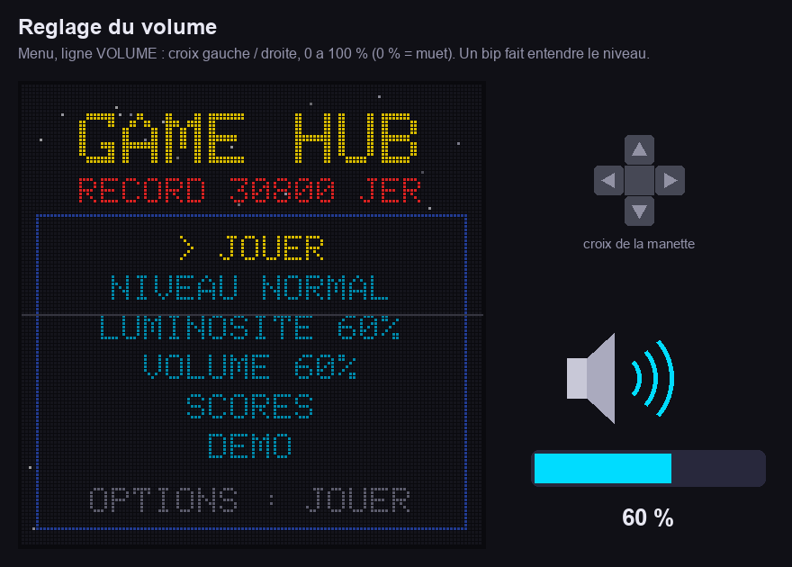
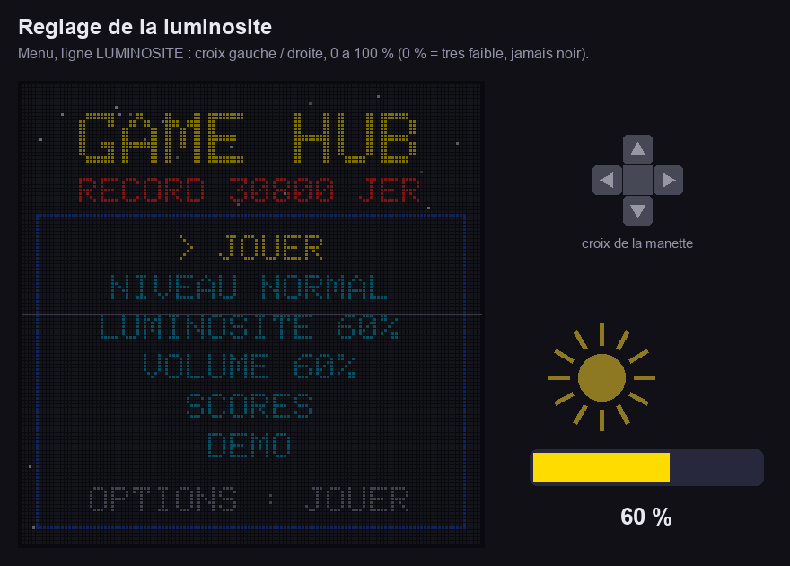
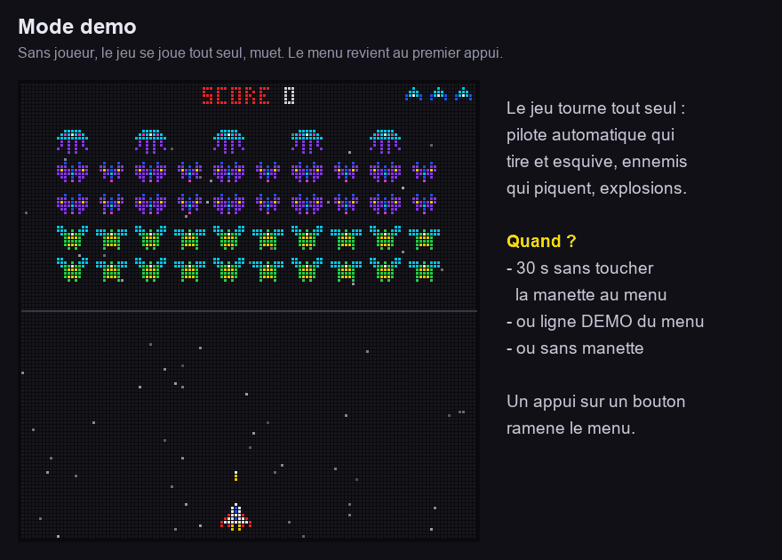
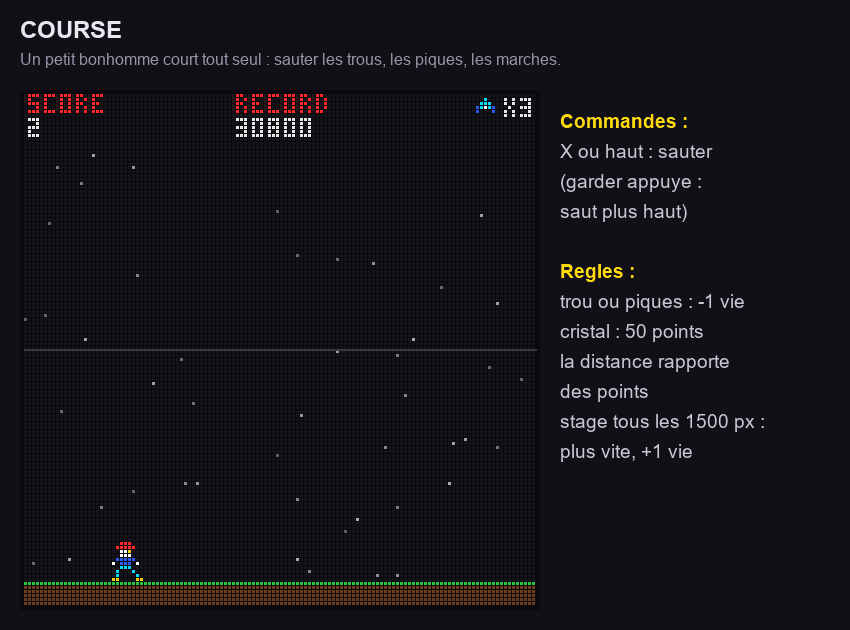
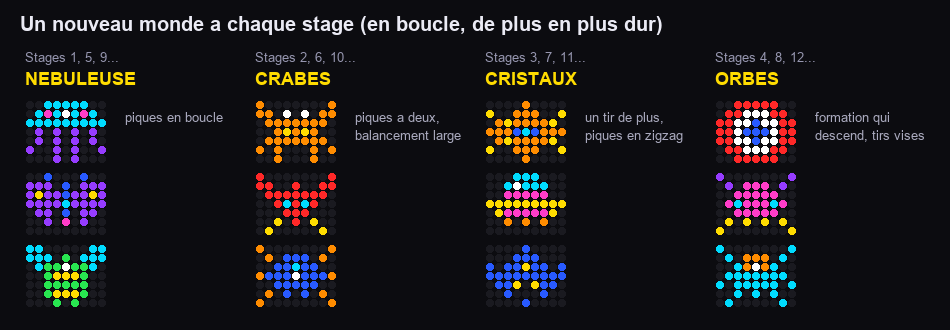
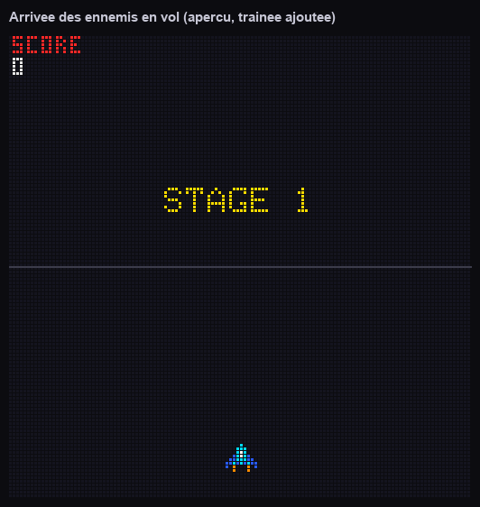
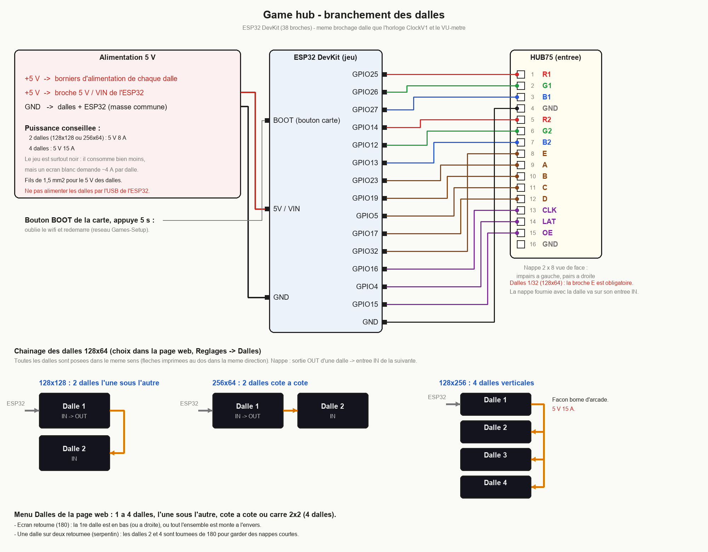

# Game hub : jeux d'arcade sur dalles LED HUB75 (ESP32 + manette PS4)

Jeux d'arcade sur 1 à 4 dalles LED 128x64, avec un ESP32 classique et une **manette PS4 reliée en Bluetooth**.

- **Pas de wifi :** la manette se connecte directement à l'ESP32 des dalles.
- **Partition unique de 3 Mo :** il reste de la place pour d'autres jeux.
- **Son en option :** une broche PWM vers un petit ampli et un haut-parleur.

**3 jeux originaux**, à choisir dans le menu :
- **ESSAIM** : le shoot'em up repris du mode Jeu du VU-mètre ;
- **RAID** : un shoot vertical avec un boss à la fin de chaque stage ;
- **COURSE** : un petit bonhomme qui court et saute.

Ils ont en commun les niveaux de difficulté, les stages, les vies, les meilleurs scores et la démo automatique.


*Aperçu simulé, généré par `docs/rendu.py` avec les mêmes sprites que le jeu. Chaque configuration en grand : [128x128](docs/rendu-128x128.png), [256x64](docs/rendu-256x64.png), [128x256](docs/rendu-128x256.png).*

## Menu

Sans partie en cours, le jeu tourne tout seul en démo, sans son. **Sans manette connectée**, la démo affiche « DEMO » et une petite indication, « MANETTE : BOUTON PS », avec l'adresse Bluetooth de l'ESP32. Dès que la manette est connectée, le menu s'affiche **sur son propre écran**, sans la démo derrière. On y voit un fond d'étoiles, le titre GAME HUB et le record avec le nom de son détenteur :


| Ligne | Action |
|---|---|
| **JOUER** | **gauche / droite : choix du jeu** (ESSAIM, RAID, COURSE). ✕ ou OPTIONS lance la partie. Le choix est gardé en mémoire. |
| **NIVEAU** | Facile / Normal / Difficile (gauche / droite ou ✕), choix gardé en mémoire |
| **LUMINOSITE** | 0 à 100 % par pas de 10 % (gauche / droite ou ✕), visible tout de suite et gardée en mémoire. À 0 %, les dalles restent très faiblement allumées pour qu'on voie encore le menu. |
| **VOLUME** | volume du son, 0 à 100 % par pas de 10 % (gauche / droite ou ✕). Un bip fait entendre le niveau. 0 % = muet. C'est le rapport cyclique du PWM : le potentiomètre de l'ampli règle le maximum. |
| **SCORES** | les 5 meilleurs scores **du jeu choisi** : rang, **nom**, score, niveau (F/N/D) et stage atteint. Chaque jeu a son propre tableau. |
| **DEMO** | lance **la démo du jeu choisi** : il tourne tout seul avec un pilote automatique, et « DEMO » clignote |

| Réglage du volume | Réglage de la luminosité |
|---|---|
|  |  |

- **Navigation :** la croix haut / bas choisit la ligne, ✕ valide.
- **OPTIONS** (le « START » de la manette PS4) lance la partie depuis n'importe quelle ligne.
- **Mode démo :** au bout de **30 s sans toucher la manette**, le menu se cache et la démo tourne seule. Le premier appui sur un bouton, ou un mouvement du stick, fait revenir le menu, sans autre effet.

  
- **En partie, OPTIONS met en pause** : OPTIONS reprend la partie, **○ (rond) revient au menu**. Si ton score entre dans les 5 meilleurs, il est enregistré.
- **Fin de partie :** « GAME OVER » s'affiche. Le jeu revient ensuite au menu, puis passe en mode démo après 30 s.
- **Saisie du nom :** si ton score entre dans les 5 meilleurs, un écran affiche « NOUVEAU RECORD ! » (ou « BRAVO ! RANG n ») puis **3 grandes lettres** à choisir, comme sur une borne d'arcade.
  - Croix haut / bas : change la lettre (A à Z, chiffres, espace, tiret).
  - Gauche / droite, ou ✕ : passe à la lettre précédente ou suivante.
  - ○ : revient à la lettre précédente.
  - OPTIONS : valide. ✕ sur la dernière lettre valide aussi.
  - Le dernier nom saisi est proposé la fois suivante.
  - Après validation, le tableau des scores s'affiche avec ton nom. Sans appui pendant 60 s, le nom est validé tel quel.

| Niveau | Vies au départ | Ennemis |
|---|---|---|
| Facile | 5 | tirent 2 fois moins, piquent moins souvent, tirs plus lents |
| Normal | 3 | — |
| Difficile | 3 | tirent plus, piquent plus souvent, tirs plus rapides |

## RAID


Un shoot vertical : tu te déplaces partout dans le bas de l'écran, et des vagues d'ennemis descendent en formation.
- **Commandes :** croix ou stick pour bouger, ✕ pour tirer (en continu si tu restes appuyé).
- **Capsules « P » :** certaines vagues en lâchent une, qui améliore ton arme (3 niveaux). Perdre une vie fait baisser l'arme d'un niveau.
- **Boss :** après 7 vagues, un gros boss apparaît, avec sa barre de vie en haut de l'écran. Il tire en éventail et vise ton vaisseau. Le détruire termine le stage : gros bonus et une vie en plus.

## COURSE



Un petit bonhomme original (casquette rouge, t-shirt bleu) court tout seul vers la droite.
- **Commandes :** ✕ ou haut pour sauter. Garde le bouton appuyé pour sauter plus haut.
- **Le parcours :** saute par-dessus les **trous** et les **piques**, et de **plateforme en plateforme**. Ramasse les **cristaux** (50 points).
- **Points et stages :** la distance parcourue rapporte des points. Tous les 1500 pixels, c'est un nouveau stage : la course va plus vite et tu gagnes une vie.

## ESSAIM (le shoot'em up)

- **Écran :** score et record en haut ; **vies en haut à droite** (une icône et le nombre, par exemple `X3`) . Le vaisseau est tout en bas de l'écran. Le stage s'affiche dans l'annonce, au début de chaque stage.
- **Vies :** Chaque stage terminé donne **une vie de plus** (9 au maximum).
- **Stages, sans fin :** quand tous les ennemis sont détruits, l'annonce « STAGE n » s'affiche avec le nom du monde et un bonus de 500 points × le numéro du stage.
  - Les ennemis tirent plus souvent à chaque stage, et leurs tirs vont plus vite.
  - Leurs piqués sont de plus en plus fréquents, jusqu'au stage 7 environ.
- **Un nouveau monde à chaque stage**, en boucle : de nouveaux ennemis, avec de nouveaux déplacements ou de nouvelles défenses.

  

  | Stages | Monde | Comportement |
  |---|---|---|
  | 1, 5, 9… | Nébuleuse | piqués en boucle |
  | 2, 6, 10… | Crabes | formation qui balance plus vite et plus large, piqués **à deux** |
  | 3, 7, 11… | Cristaux | **un tir de plus** pour chaque ennemi, piqués **en zigzag** |
  | 4, 8, 12… | Orbes | la formation **descend et remonte**, et leurs tirs **visent ton vaisseau** |
- **Arrivée en vol :** les ennemis arrivent en files, par groupes en miroir. Ils suivent des trajectoires courbes avec des boucles, puis rejoignent leur place. Abattus en vol, ils rapportent **double**.

  

- **Le vaisseau évolue à chaque stage :**

  

  | Stage | Vaisseau |
  |---|---|
  | 1 | de base, un tir |
  | 2 | **tir rapide** (ailes vertes) |
  | 3 | **double canon**, deux tirs parallèles |
  | 4 et + | **triple canon**, tirs en éventail |

- **Abandon :** une partie sans aucun appui pendant 1 min repasse en démo.

## Manette PS4


| Manette | Action |
|---|---|
| stick gauche ou croix gauche / droite | bouger |
| stick gauche ou croix haut / bas | avancer / reculer (dans le bas de l'écran, environ 45 %) |
| croix, rond, carré, triangle, R1, L1 ou R2 | tirer |
| OPTIONS | jouer depuis le menu, pause en partie |
| ○ (rond), pendant la pause | quitter la partie et revenir au menu |
| croix haut / bas, au menu | choisir la ligne |
| Share + croix haut / bas | luminosité (enregistrée), aussi réglable dans le menu |
| Share + Options pendant 3 s | redémarrer l'ESP32 |

- **Vibration :** la manette vibre quand ton vaisseau est touché.
- **Barre lumineuse :** bleu sombre au menu, puis la couleur de l'évolution du vaisseau.

**Connexion, une seule fois.** Une manette PS4 ne se connecte qu'à l'adresse Bluetooth qu'elle a enregistrée. Il y a deux façons de faire.

**Méthode 1 (la plus simple) : écrire l'adresse de l'ESP32 dans la manette.**
1. Pendant la démo, la dalle affiche l'adresse Bluetooth de l'ESP32 sous « MANETTE: BOUTON PS ». Le moniteur série l'affiche aussi.
2. Branche la manette en USB sur le PC et lance **SixaxisPairTool**. Tape l'adresse de l'ESP32 dans « Change Master », puis clique sur Update.
3. Débranche la manette et appuie sur **PS**.

Pour rejouer sur la PS4 ensuite, il suffit de rebrancher la manette en USB sur la console et d'appuyer sur PS.

**Méthode 2 : l'ESP32 prend l'adresse de la console.** La manette continue alors de marcher sur la PS4 sans rien refaire.
1. Avec SixaxisPairTool, lis l'adresse « Current Master » de la manette : c'est celle de la console.
2. Dans le moniteur série de l'ESP32, tape `a 1a:2b:3c:4d:5e:6f` (avec cette adresse), puis Entrée. L'ESP32 redémarre.
3. Appuie sur **PS**.

La commande `a` seule rend à l'ESP32 son adresse d'origine.

## Son (option) : une broche PWM


Le son passe par **une seule broche, GPIO 22** (depuis la V2.23). L'ESP32 y sort des notes carrées, façon consoles 8 bits, sans I2S et presque sans travail pour le processeur. Le signal est filtré, puis envoyé à un ampli analogique.

- **Le module ampli :** sur le schéma, la carte verte porte la puce au centre, le potentiomètre de volume, l'entrée L / GND / R à gauche, les borniers des haut-parleurs (L+ L- R+ R-) à droite et le bornier d'alimentation + / - en bas. Suis les repères imprimés sur ta carte : l'ordre peut changer d'un vendeur à l'autre.
- **Filtre :** 1 kΩ en série, 10 nF vers la masse, puis 10 µF en série vers l'entrée de l'ampli. Relie l'entrée L à l'entrée R : le son est mono.
- **Amplis NS4110B ou PAM8610 :** ils demandent **7 à 15 V**, pas le 5 V des dalles. Alimente-les avec un bloc 12 V à part, ou avec un élévateur 5 V → 12 V (MT3608, XL6009).
- **Plus simple :** un **PAM8403** (2 x 3 W) fonctionne directement en 5 V.
- **Masse commune** obligatoire entre l'ampli et l'ESP32.
- **Volume :** avec le potentiomètre de l'ampli. Commence au minimum.

- **Bruitages :** tir, explosion, vaisseau touché, piqué d'un ennemi, jingles de stage, de nouvelle arme et de fin de partie, bips du menu et de la saisie du nom. La démo reste muette.
- **Une seule voix :** un son important (vaisseau touché, explosion) passe avant un son mineur (tir, bip).
- **Volume :** ligne VOLUME du menu (0 à 100 %), ou `v 0` à `v 10` dans le moniteur série, en plus du potentiomètre de l'ampli.
- **Sans ampli branché :** le jeu marche normalement.

## Ancien son I2S (retiré)

De la V2.01 à la V2.22, le son passait par un ampli I2S MAX98357A (GPIO 22, 21, 33). Le canal audio I2S faisait perdre à la manette PS4 la plupart de ses paquets, et les commandes devenaient lentes, même sans ampli branché. Il a été remplacé en V2.23 par le son PWM ci-dessus, qui ne demande presque rien au processeur. L'ancien code reste dans l'historique Git.

## Branchement



| Écran | Dalles | Montage (ordre de la chaîne) | Commande |
|---|---|---|---|
| 128x128 | 2 | l'une sous l'autre, la 1ʳᵉ (reliée à l'ESP32) en haut | `c 2000` |
| 256x64 | 2 | côte à côte, la 1ʳᵉ à gauche | `c 2100` |
| 128x256 | 4 | l'une sous l'autre, écran vertical façon borne d'arcade, 7 rangées d'ennemis | `c 4000` |
| 256x128 | 4 | carré 2x2 : haut gauche → haut droite → bas gauche → bas droite | `c 4200` |

- **Écran retourné à 180°** (4ᵉ chiffre de la commande à 1, par exemple `c 2010`) : la 1ʳᵉ dalle est en bas ou à droite, ou tout l'ensemble est monté à l'envers.
- **Une dalle sur deux retournée** (dernier chiffre à 1, par exemple `c 2001`) : câblage en serpentin, pour garder des nappes courtes.

**Alimentation 5 V :** 8 A pour 2 dalles, 15 A pour 4. N'alimente pas les dalles par l'USB de l'ESP32.

## Moniteur série (115200 bauds)

| Commande | Effet |
|---|---|
| `?` | aide et état (adresse Bluetooth, dalles, couleurs, volume) |
| `a xx:xx:xx:xx:xx:xx` | adresse Bluetooth que prend l'ESP32, celle de la console. `a` seule revient à l'adresse d'origine |
| `c NDFS` | dalles. N : nombre (1 à 4). D : disposition (0 l'une sous l'autre, 1 côte à côte, 2 carré). F : écran retourné (0/1). S : serpentin (0/1) |
| `p N` | couleurs des dalles sur N bits (3 à 6) |
| `v N` | volume du son, de 0 à 10 |
| `e 0` / `e 1` / `e x` | test des pertes Bluetooth : LED éteintes / rallumées / transfert vers les dalles arrêté (jusqu'au redémarrage) |

Les commandes `a`, `c` et `p` redémarrent l'ESP32. Les réglages sont gardés en mémoire.

**Couleurs et mémoire :** le Bluetooth demande beaucoup de mémoire, surtout à la connexion de la manette. Les dalles sont donc en **3 bits** par défaut. Tu peux essayer `p 4` pour avoir plus de nuances. Si l'ESP32 plante 2 fois de suite, il revient tout seul à 3 bits. Le moniteur série affiche la mémoire libre à la connexion, puis toutes les 2 s.

## Firmware

Le programme utilise une **partition unique de 3 Mo** (« Huge APP », sans mise à jour par wifi). Il y a deux fichiers :

| Fichier | Quand | Adresse |
|---|---|---|
| `GameHub_V<version>_complet.bin` | **1er flash**, ou en venant d'une ancienne version (table des partitions différente) | **0x0** |
| `GameHub_V<version>.bin` | mises à jour suivantes | 0x10000 |

Les réglages (dalles, luminosité, scores, niveau, adresse de la manette, volume) sont conservés.

| Binaire | Adresse | MD5 |
|---|---|---|
| [firmware/GameHub_V3.00_complet.bin](firmware/GameHub_V3.00_complet.bin) | 0x0 | `4e03015a77cd250584285c637bc1a7dc` |
| [firmware/GameHub_V3.00.bin](firmware/GameHub_V3.00.bin) | 0x10000 | `72e420ee251d08e65cacf76553d33fa6` |

Avec l'Arduino IDE, choisis le schéma de partition **Huge APP (3MB No OTA/1MB SPIFFS)** dans Outils → Partition Scheme.

## Compilation

```powershell
./build.ps1    # arduino-cli, ESP32 classique, core 2.0.17, partition Huge APP
               # -> GameHub_V<version>.bin et GameHub_V<version>_complet.bin
```

- **Bibliothèques :** ESP32-HUB75-MatrixPanel-I2S-DMA et Adafruit GFX.
- **PS4Controller 1.1.0 :** une copie corrigée est incluse dans `games/src/PS4Controller/` (licence GPL-3, modification signalée dans `ps4_l2cap.c`).
  - Avec le core ESP32 2.0.17, la bibliothèque d'origine lisait les paquets de la manette décalés d'un octet : seul « haut » était détecté et la batterie était fausse.
  - La copie corrigée cherche l'en-tête du paquet avant de le lire.
  - Elle demande aussi à la manette un rapport toutes les 4 ms. Avec 0, elle n'en envoyait qu'environ un toutes les 2 s, et les appuis brefs étaient perdus.
  - Le jeu interdit enfin le mode veille Bluetooth (sniff) et force le lien de la manette en mode actif dès le premier rapport. Le moniteur série affiche le nombre de paquets reçus par seconde.
- **Plans, aperçus et GIF :** `python docs/branchement.py`, `python docs/rendu.py`, `python docs/gif_manette_ps4.py`, `python docs/gif_arrivee.py`, `python docs/gif_menus.py`, `python docs/gif_jeux.py`, `python docs/branchement_son.py` (Pillow).

L'ancienne version avec wifi, page web et manette ESP-NOW reste disponible dans l'historique Git, jusqu'au commit `fb11367`.
