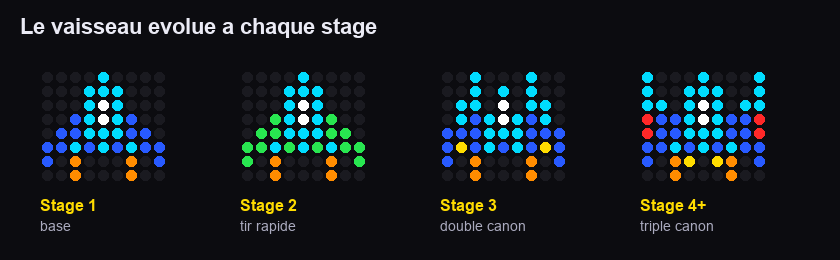
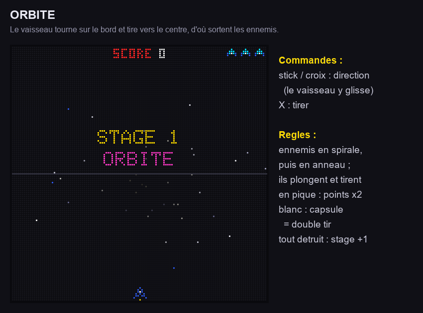
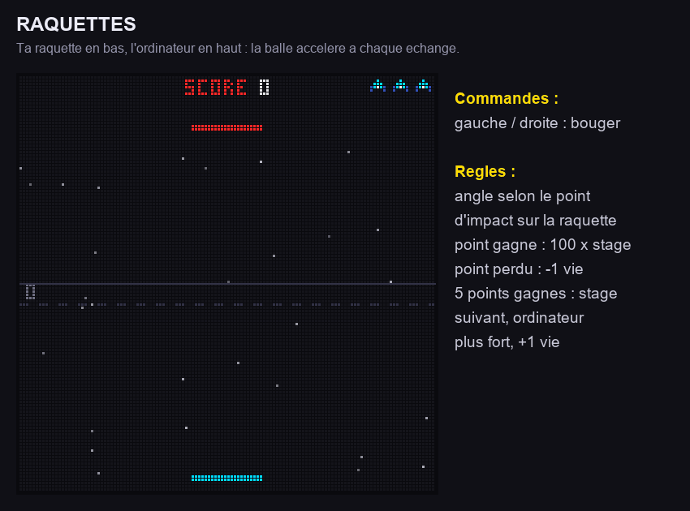
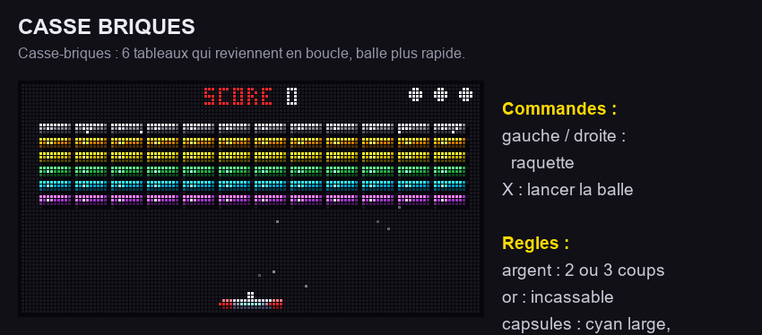
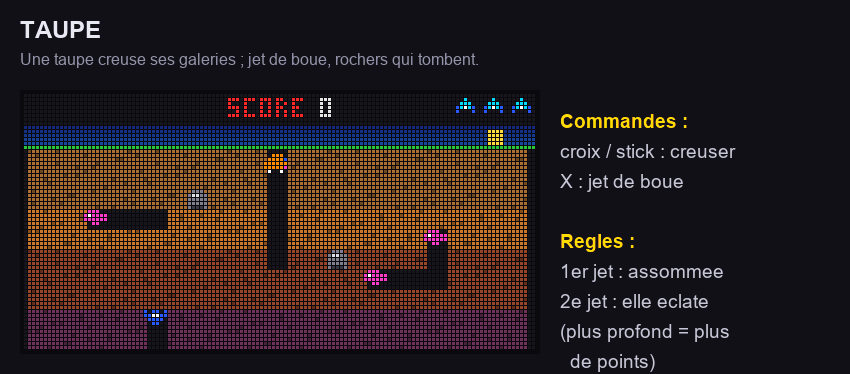
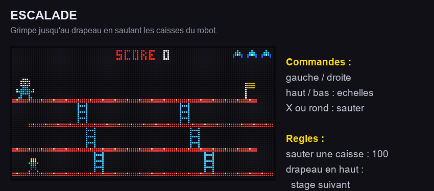
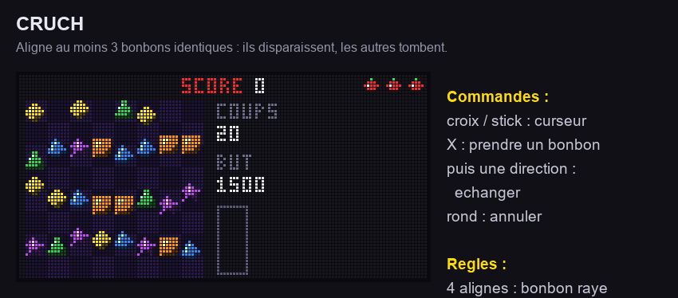
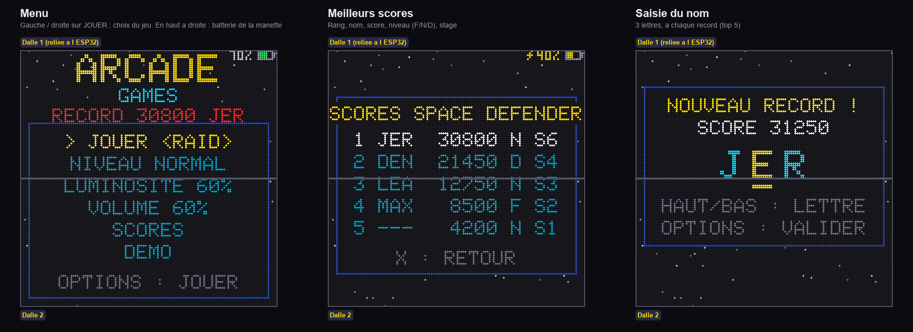
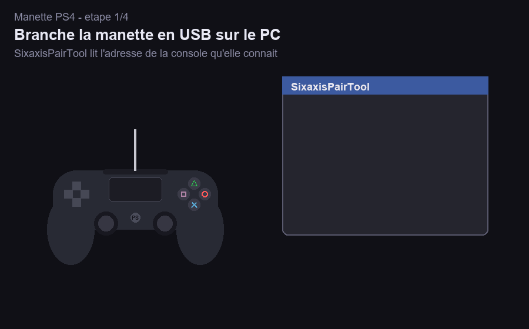
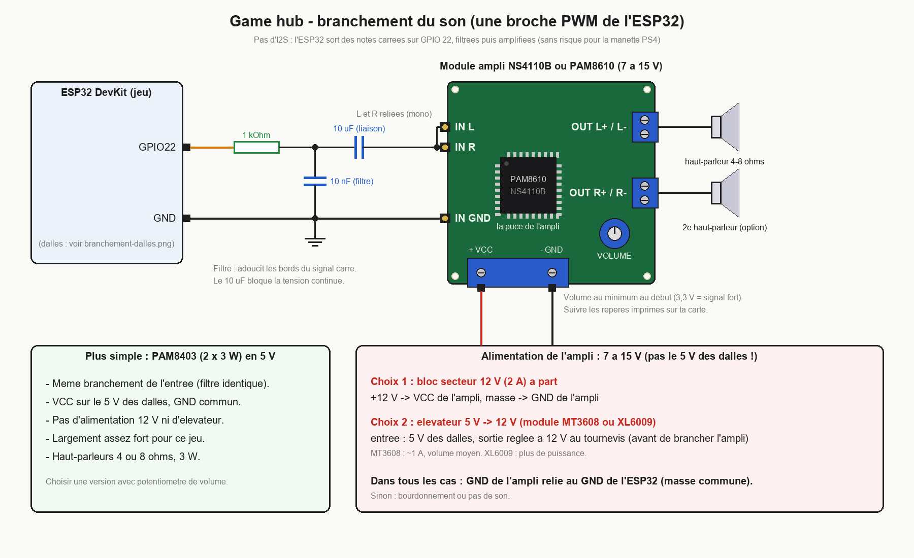

# Game hub : jeux d'arcade sur dalles LED HUB75 (ESP32 + manette PS4)

Jeux d'arcade sur 1 à 4 dalles LED 128x64, avec un ESP32 classique et une **manette PS4 reliée en Bluetooth**.

- **Pas de wifi :** la manette se connecte directement à l'ESP32 des dalles.
- **Partition unique de 3 Mo :** il reste de la place pour d'autres jeux.
- **Son en option :** une broche PWM vers un petit ampli et un haut-parleur.

**12 jeux originaux**, à choisir dans le menu (gauche / droite sur la ligne JOUER). Au démarrage, c'est toujours **SPACE DEFENDER** qui est proposé.

Les 12 jeux ont en commun les niveaux de difficulté, les stages, les vies, les meilleurs scores avec les noms et la démo automatique.


## Branche bluepad32 : deux manettes (essai)

Cette branche remplace la bibliothèque PS4Controller par **Bluepad32** : jusqu'à 4 manettes Bluetooth (PS4, PS5, Xbox...).

- **Installation** : 1er flash avec `firmware/GameHub_V3.82_bp32_complet.bin` à **0x0** (le démarrage change), ensuite `GameHub_V3.82_bp32.bin` à 0x10000. Compilation : `build_bp32.ps1` (carte « ESP32 + Bluepad32 », `esp32-bluepad32:esp32` 4.1.0).
- **Associer une manette** : appuyer sur **Share + PS** jusqu'au clignotement rapide de la barre lumineuse. Plus d'adresse à recopier. La 1re manette connectée est le joueur 1, la 2e le joueur 2. Moniteur série : `a` oublie toutes les manettes associées. Sur la dalle : « MANETTE 2 OK » / « MANETTE 1 PARTIE » à chaque connexion, et dans le menu `JOUEURS <2> **` (une étoile par manette connectée).
- **Menu « JOUEURS 1 / 2 »** : seuls les jeux à deux joueurs utilisent la 2e manette.
  - **RAQUETTES** : match à deux (raquette de droite pour le joueur 2), **le premier à 7 points gagne**.
  - **SPACE DEFENDER** : coopération, un 2e vaisseau **vert** pour le joueur 2, vies et score communs ; les ennemis piquent sur l'un ou l'autre ; la manette du joueur touché vibre.
- **Mémoire** : environ 87 Ko libres avec 2 dalles en 3 bits et une manette connectée (une manette en plus : environ 4 Ko).

# SPACE DEFENDER

Le jeu principal : un shoot'em up original, repris du mode Jeu du VU-mètre. Une formation d'ennemis arrive en vol, change de monde à chaque stage, et ton vaisseau évolue.


*Aperçu simulé, généré par `docs/rendu.py` avec les mêmes sprites que le jeu. Chaque configuration en grand : [128x128](docs/rendu-128x128.png), [256x64](docs/rendu-256x64.png), [128x256](docs/rendu-128x256.png).*


- **Écran :** le **score centré en haut**, sur une ligne. Le record n'est plus affiché pendant le jeu : il est dans le menu et sur la page des scores. Les **vies** sont en haut à droite, avec une petite icône par vie (au-delà de 5 : une icône et le nombre). C'est pareil dans tous les jeux . Le vaisseau est tout en bas de l'écran. Le stage s'affiche dans l'annonce, au début de chaque stage.
- **Vies :** Chaque stage terminé donne **une vie de plus** (9 au maximum).
- **Stages, sans fin :** quand tous les ennemis sont détruits, l'annonce « STAGE n » s'affiche avec le nom du monde et un bonus de 500 points × le numéro du stage.
  - Les ennemis tirent plus souvent à chaque stage, et leurs tirs vont plus vite.
  - Leurs piqués sont de plus en plus fréquents, jusqu'au stage 7 environ.
- **Un nouveau monde à chaque stage**, en boucle : de nouveaux ennemis, avec de nouveaux déplacements ou de nouvelles défenses. Les ennemis sont des sprites originaux multicolores : méduse, papillon et guêpe (Nébuleuse), crabe, mante et araignée (Crabes), fleur de cristal, soucoupe et raie (Cristaux), orbe et araignée à cornes (Orbes). Le vaisseau de base est un chasseur blanc et rouge au cockpit bleu.

  

  | Stages | Monde | Comportement |
  |---|---|---|
  | 1, 5, 9… | Nébuleuse | piqués en boucle |
  | 2, 6, 10… | Crabes | formation qui balance plus vite et plus large, piqués **à deux** |
  | 3, 7, 11… | Cristaux | **un tir de plus** pour chaque ennemi, piqués **en zigzag** |
  | 4, 8, 12… | Orbes | la formation **descend et remonte**, et leurs tirs **visent ton vaisseau** |
- **Les méduses de la rangée du haut**, les plus rares, demandent 2 tirs. Détruites, elles **éclatent en 4 petits vaisseaux** qui plongent aussitôt vers toi, et qui replongent du haut de l'écran tant qu'ils ne sont pas abattus.
- **Formation :** 10 ennemis par rangée sur une dalle de 128 de large. Il reste de la place sur les côtés, alors l'essaim se balance bien de droite à gauche.
- **Boss tous les 4 stages (4, 8, 12…) :** une fois la formation détruite, un grand vaisseau-mère arrive en haut de l'écran. Il va et vient et tire en éventail, et sa barre de vie s'affiche sous le score.
  - **2e phase :** sous la moitié de sa vie, il devient rouge et tire plus souvent, en éventail de 5.
  - **Quand tu le casses :** gros bonus (2000 × numéro du boss), puis il **éclate en 5 petits vaisseaux qui plongent aussitôt vers toi**. Il faut les détruire pour passer au stage suivant.
  - Il est plus résistant à chaque nouveau boss, et selon le niveau choisi (facile, normal, difficile).
- **Arrivée en vol :** les ennemis arrivent en files, par groupes en miroir. Ils suivent des trajectoires courbes avec des boucles, puis rejoignent leur place. Abattus en vol, ils rapportent **double**.

  

- **Le vaisseau évolue à chaque stage :**

  

  | Stage | Vaisseau |
  |---|---|
  | 1 | de base, un tir |
  | 2 | **tir rapide** (ailes vertes) |
  | 3 | **double canon**, deux tirs parallèles |
  | 4 et + | **triple canon**, tirs en éventail |

- **Abandon :** une partie sans aucun appui pendant 1 min repasse en démo.

# Les autres jeux

### RAID


Un shoot vertical : tu te déplaces partout dans le bas de l'écran, et les vagues d'ennemis descendent.
- **Commandes :** croix ou stick pour bouger, ✕ pour tirer (en continu si tu restes appuyé), **○ pour une bombe**.
- **Ennemis :**
  - des lignes et des diagonales ;
  - des éventails ;
  - des **kamikazes**, qui foncent sur ton vaisseau ;
  - des **tourelles**, qui s'arrêtent en haut et tirent en éventail.

  Touchés, ils clignotent en blanc.
- **Capsules :**
  - **P** améliore l'arme, sur 3 niveaux, jusqu'à 5 tirs en éventail. Perdre une vie fait baisser l'arme d'un niveau.
  - **S** donne un bouclier, qui encaisse un tir.
  - **B** ajoute une bombe. Les bombes restantes s'affichent en bas à gauche.
- **Bombe (○) :** elle détruit les ennemis à l'écran, efface leurs tirs et blesse le boss.
- **Boss :** après 8 vagues, un boss apparaît, avec sa barre de vie en haut. Il y a 3 boss différents, qui alternent selon le stage : une coque à canons, un crabe à pinces et un noyau à bras tournants.
  - Sous la moitié de sa vie, le boss passe en **2ᵉ phase** : plus rapide, avec des tirs en spirale.
  - Le détruire termine le stage : gros bonus et une vie en plus.

### BULLES


Un petit blob cyan original souffle des bulles, sur un écran de plateformes différent à chaque niveau.
- **Le décor :** murs de 5 pixels et plateformes épaisses en briques, avec une arête claire et des joints, aux couleurs du niveau.
- **Commandes :** gauche / droite pour marcher, **haut ou ○ pour sauter**, **✕ pour souffler une bulle**. On traverse les plateformes par-dessous en sautant, et on retombe dessus.
- **Piéger un ennemi :** une bulle qui touche un ennemi l'**enferme**, puis monte vers le plafond. **Touche la bulle** pour la faire éclater : l'ennemi devient un **cristal** qui tombe, et le ramasser rapporte 500 points. Éclater plusieurs bulles à la suite donne un bonus de chaîne.
- **Attention :** une bulle qui clignote en rouge va éclater toute seule, et l'ennemi s'échappe, en colère et plus rapide. Au bout de 40 s, tous les ennemis s'énervent.
- **Les ennemis :** ceux des mondes de SPACE DEFENDER. Certains marchent et sautent d'étage en étage, et à partir du niveau 2, les insectes volent en diagonale.
- **Niveau gagné :** tous les ennemis sont éliminés. Tu passes à un nouveau plan, avec plus d'ennemis, et tu gagnes une vie en plus.

### LABYRINTHE


Un petit scarabée vert ramasse toutes les graines d'un labyrinthe original, poursuivi par 4 créatures piquantes.
- **Vies :** petites créatures piquantes en haut à droite, chacune d'une couleur différente (6 couleurs).
- **Sur une seule dalle (128x64)**, le labyrinthe garde des cases de 6 pixels et **défile verticalement** pour suivre le scarabée. Il tient en entier à partir de 128x128.
- **Graphisme :** murs « néon » aux coins arrondis (couleur différente à chaque stage), grosses graines qui pulsent, créatures aux piquants qui tournent et aux yeux qui regardent où elles vont, scarabée avec carapace, reflet, tête et pattes qui bougent.
- **Commandes :** croix ou stick pour diriger le scarabée. La direction choisie est gardée jusqu'au prochain croisement possible.
- **Les créatures :** chacune a son caractère.
  - La violette fonce droit sur toi.
  - L'orange vise devant toi.
  - La verte essaie de te prendre en tenaille.
  - La blanche, timide, repart dans son coin quand elle est trop près.
- **Grosse graine lumineuse :** pendant quelques secondes, les créatures deviennent **bleues** et fuient. En attraper une rapporte 200, 400, 800 puis 1600 points, et elle retourne à sa maison.
- **Couloir du milieu :** il est ouvert sur les deux côtés. Sortir d'un côté fait ressortir de l'autre.
- **Stages :** tout manger fait passer au stage suivant. Les créatures sont plus rapides, les murs changent de couleur, et tu gagnes une vie.

### ORBITUS



Ton vaisseau **tourne sur le bord de l'écran** et tire **vers le centre**. Les étoiles jaillissent du centre, ce qui donne de la profondeur.
- **Commandes :** pousse le stick dans une direction, et le vaisseau **glisse sur son orbite** jusque-là. Avec la **croix numérique**, gauche / droite le font **tourner en continu** (tour complet), haut / bas / diagonales l'envoient vers cette direction. ✕ (ou carré, triangle, R1, L1, R2) pour tirer en continu.
- **Les ennemis :** ils sortent du centre **en spirale**, se rangent en anneau, puis **plongent vers toi** en tirant. Ils grossissent en approchant : un point au loin, une petite croix, puis le sprite.
- **Couleurs :** de près, les ennemis sont des sprites en couleurs (méduse, soucoupe, papillon, satellite) ; leurs couleurs **changent à chaque stage** (4 jeux de couleurs). Ton vaisseau a des bords cyan, des feux rouges au bout des ailes et un réacteur qui scintille.
- **Points :** 50, 80 ou 100 selon l'ennemi, **doublés s'il est en piqué**.
- **Ennemi blanc :** il lâche une capsule. Rattrape-la sur ton orbite pour avoir le **double tir**, jusqu'à la prochaine vie perdue.
- **Stages :** 4 vagues de 8 ennemis au stage 1, puis une vague de plus tous les 2 stages (jusqu'à 7 vagues, 56 ennemis). Tout détruire fait passer au stage suivant, avec un **saut en hyperespace** (les étoiles accélèrent). Les ennemis piquent plus souvent, et tu gagnes une vie.

### RAQUETTES



Une balle et deux raquettes, **à l'horizontale** : la tienne à gauche, celle de l'ordinateur à droite.
- **Commandes :** haut / bas pour déplacer ta raquette. Avec le **stick analogique**, elle va d'autant plus vite que tu le pousses loin.
- **La balle :** son angle dépend de l'endroit où elle touche la raquette, et elle accélère à chaque échange. Elle rebondit en haut et en bas.
- **Raquettes** plus courtes (10 pixels sur une dalle 128x64, 16 en 128x128).
- **Points :** un point gagné rapporte 100 × le stage. Près du filet : tes points du stage (cyan) à gauche, ceux de l'ordinateur (rouge) à droite. Au 3e point de l'ordinateur, la partie est finie (pas d'icônes de vies en haut).
- **Stages :** 5 points gagnés font passer au stage suivant. L'ordinateur devient plus rapide, les raquettes un peu plus petites.
- **À deux manettes :** pas possible pour l'instant. La bibliothèque de la manette n'en gère qu'une à la fois ; il faudrait passer à une autre bibliothèque (Bluepad32).

### CASSE BRIQUES



Un casse-briques original. Une raquette en bas renvoie la balle vers un mur de briques.
- **Vies :** de petites balles blanches en haut à droite.
- **Commandes :** stick ou croix gauche / droite pour la raquette (au **stick**, elle va d'autant plus vite que tu le pousses loin), **✕ pour lancer la balle**.
- **Briques :** de couleur (1 coup, plus elles sont hautes plus elles rapportent), **d'argent** (2 coups, 3 à partir du stage 6) et **d'or** (incassables, à partir du stage 4). Chaque brique a un reflet et une ombre.
- **Capsules :** une brique cassée lâche parfois une capsule qui tombe. Cyan : **raquette large**. Orange : **balle lente**. Magenta : **3 balles**. Rouge : **une vie**.
- **Tableaux :** 6 dessins (mur plein, damier, pyramide, losange, rangées avec argent, motif) qui reviennent en boucle. Tout casser (sauf l'or) fait passer au suivant, avec une balle plus rapide et une vie en plus.

### BLOCS


Des blocs qui tombent, à empiler pour compléter des lignes.
- **Commandes :** gauche / droite pour déplacer la pièce (en gardant appuyé, elle glisse), **bas** pour descendre plus vite, **haut** pour la faire tomber d'un coup, **✕** pour la tourner dans un sens, **○** dans l'autre.
- **À l'écran :** blocs en relief (reflet, ombre), **pièce fantôme** qui montre où la pièce va tomber, pièce suivante à droite, lignes et niveau à gauche.
- **Points :** 1, 2, 3 ou 4 lignes d'un coup : 100, 300, 500 ou 800 × le niveau. Les lignes complètes clignotent puis disparaissent.
- **Niveaux :** toutes les 10 lignes, les pièces tombent plus vite. **Une seule partie** (pas de vies) : si la pile atteint le haut, la partie est finie.

### TAUPE



Un jeu de creusage original : une taupe creuse ses galeries sous terre (4 couches de terre de couleurs différentes).
- **Commandes :** croix ou stick pour se déplacer (creuser ralentit), **✕ ou ○ : jet de boue** (3 cases devant).
- **Les créatures :** des vers roses qui suivent les galeries, et des chauves-souris qui traversent parfois la terre (on ne voit que leurs yeux).
- **Jet de boue :** une créature touchée est **assommée** (elle clignote) ; touchée une 2e fois, elle **éclate**. Plus elle est profonde, plus elle rapporte.
- **Rochers :** creuser sous un rocher le fait trembler puis **tomber** : il écrase les créatures (gros bonus)… et la taupe si elle est dessous.
- **Stages :** toutes les créatures éliminées : stage suivant, avec plus de créatures et de rochers.

### BILLES


Un jeu de tir de billes original, dans un puits.
- **Commandes :** gauche / droite pour viser (au **stick**, l'angle suit directement le stick), **✕ pour tirer**. Des pointillés montrent la trajectoire, rebonds compris.
- **Règles :** la bille rebondit sur les murs et se colle à la grappe. **3 billes de même couleur ou plus éclatent** ; celles qui ne tiennent plus au plafond **tombent** (gros bonus).
- **Plafond :** il descend d'un rang **tous les 8 tirs** (les marques orange en bas à droite). Une bille qui dépasse la ligne rouge : partie finie (une seule partie, pas de vies).
- **Stages :** tout vider fait passer au suivant, avec plus de rangées et plus de couleurs.

### ESCALADE



Un jeu de plateformes original : un robot géant, en haut à gauche, lance des caisses qui roulent sur les poutres.
- **Commandes :** gauche / droite pour marcher, haut / bas pour monter ou descendre les échelles, **✕ ou ○ pour sauter**.
- **Les caisses :** elles roulent d'un bout à l'autre de chaque poutre, tombent par le trou à l'étage du dessous, et prennent parfois une échelle.
- **Points :** sauter par-dessus une caisse rapporte 100 points ; monter un étage, 20.
- **But :** atteindre le **drapeau** en haut à droite : stage suivant, avec des caisses plus rapides et plus nombreuses.

### CRUCH



Des bonbons à aligner sur un plateau de 8 × 8. Six sortes, chacune avec sa couleur et sa forme (rond, carré, losange, triangle, goutte, étoile), pour bien les distinguer.
- **Vies :** de petites pommes en haut à droite.
- **Commandes :** croix ou stick pour déplacer le curseur, **✕ pour prendre un bonbon** (le curseur clignote en jaune), puis une **direction pour l'échanger** avec son voisin. ○ annule.
- **Alignements :** 3 bonbons identiques ou plus disparaissent, ceux du dessus tombent et de nouveaux arrivent par le haut. Les **réactions en chaîne** rapportent de plus en plus. Un échange qui n'aligne rien est annulé.
- **Bonbons spéciaux :** en aligner **4** laisse un **bonbon rayé**, qui vide toute sa ligne ou sa colonne quand il disparaît. En aligner **5** laisse une **bombe** : échange-la avec un bonbon pour faire disparaître toute sa couleur.
- **Niveaux :** un score à atteindre (la jauge à droite) en un nombre de **coups** limité. Réussi : niveau suivant, bonus pour les coups restants et une vie en plus. Raté : une vie perdue, on recommence le niveau.

## Menu

Au démarrage, la dalle affiche **ARCADE GAMES** (en vert) et la **version** (par exemple V3.70) pendant 2 s, le temps que le Bluetooth et le son démarrent.

Sans partie en cours, le jeu tourne tout seul en démo, sans son. **La démo change de jeu au hasard toutes les 5 minutes** (au retour au menu, le jeu choisi est remis). **Sans manette connectée**, la démo affiche seulement une petite indication, « MANETTE : BOUTON PS », avec l'adresse Bluetooth de l'ESP32. Dès que la manette est connectée, le menu s'affiche **sur son propre écran**, sans la démo derrière. On y voit un fond d'étoiles, le titre ARCADE GAMES et le record avec le nom de son détenteur :

**Batterie de la manette :** en haut à droite du menu, un pourcentage et une petite pile (verte, orange, puis rouge qui clignote quand elle est faible). En charge, la pile est jaune, avec un éclair et une jauge qui se remplit en boucle.



| Ligne | Action |
|---|---|
| **JOUER** | **gauche / droite : choix du jeu** (SPACE DEFENDER, RAID, RAQUETTES, BULLES, LABYRINTHE, ORBITUS, CASSE BRIQUES, BLOCS, CRUCH, TAUPE, BILLES, ESCALADE). Au démarrage : SPACE DEFENDER. ✕ ou OPTIONS lance la partie. |
| **NIVEAU** | Facile / Normal / Difficile (gauche / droite ou ✕), choix gardé en mémoire |
| **LUMINOSITE** | 0 à 100 % par pas de 10 % (gauche / droite ou ✕), visible tout de suite et gardée en mémoire. À 0 %, les dalles restent très faiblement allumées pour qu'on voie encore le menu. |
| **VOLUME** | volume du son, 0 à 100 % par pas de 10 % (gauche / droite ou ✕). Un bip fait entendre le niveau. 0 % = muet. C'est le rapport cyclique du PWM : le potentiomètre de l'ampli règle le maximum. |
| **SCORES** | les 5 meilleurs scores **du jeu choisi** : rang, **nom**, score, niveau (F/N/D) et stage atteint. Chaque jeu a son propre tableau. |
| **DEMO** | lance **la démo du jeu choisi** : il tourne tout seul avec un pilote automatique, sans texte par-dessus (seules les annonces de stage s'affichent) |

| Réglage du volume | Réglage de la luminosité |
|---|---|
|  |  |

- **Navigation :** la croix haut / bas choisit la ligne, ✕ valide.
- **OPTIONS** (le « START » de la manette PS4) lance la partie depuis n'importe quelle ligne.
- **Mode démo :** au bout de **30 s sans toucher la manette**, le menu se cache et la démo tourne seule. Le premier appui sur un bouton, ou un mouvement du stick, fait revenir le menu, sans autre effet.
- **En partie, OPTIONS met en pause** : OPTIONS reprend la partie, **○ (rond) revient au menu**. Si ton score entre dans les 5 meilleurs, il est enregistré.
- **Fin de partie :** « GAME OVER » s'affiche. Le jeu revient ensuite au menu, puis passe en mode démo après 30 s.
- **Saisie du nom :** si ton score entre dans les 5 meilleurs, un écran affiche « NOUVEAU RECORD ! » (ou « BRAVO ! RANG n ») puis **3 grandes lettres** à choisir, comme sur une borne d'arcade.
  - Croix haut / bas : change la lettre (A à Z, chiffres, espace, tiret).
  - Gauche / droite, ou ✕ : passe à la lettre précédente ou suivante.
  - ○ : revient à la lettre précédente.
  - OPTIONS : valide. ✕ sur la dernière lettre valide aussi.
  - Le dernier nom saisi est proposé la fois suivante.
  - Après validation, le tableau des scores s'affiche avec ton nom. Sans appui pendant 60 s, le nom est validé tel quel.

| Niveau | Vies au départ | Ennemis |
|---|---|---|
| Facile | 5 | tirent 2 fois moins, piquent moins souvent, tirs plus lents |
| Normal | 3 | — |
| Difficile | 3 | tirent plus, piquent plus souvent, tirs plus rapides |

## Manette PS4



| Manette | Action |
|---|---|
| stick gauche ou croix gauche / droite | bouger |
| stick gauche ou croix haut / bas | avancer / reculer (dans le bas de l'écran, environ 45 %) |
| croix, carré, triangle, R1, L1 ou R2 | tirer (SPACE DEFENDER, RAID, ORBITUS, BILLES), jet de boue (TAUPE), sauter (ESCALADE), lancer la balle (CASSE BRIQUES), tourner la pièce (BLOCS), prendre un bonbon (CRUCH) |
| ○ (rond) | bombe dans RAID, saut dans BULLES, tourner dans l'autre sens (BLOCS), annuler (CRUCH) ; dans les menus : retour |
| OPTIONS | jouer depuis le menu, pause en partie |
| ○ (rond), pendant la pause | quitter la partie et revenir au menu |
| croix haut / bas, au menu | choisir la ligne |
| Share + croix haut / bas | luminosité (enregistrée), aussi réglable dans le menu |
| Share + Options pendant 3 s | redémarrer l'ESP32 |

- **Vibration :** la manette vibre quand ton vaisseau est touché.
- **Barre lumineuse :** bleu sombre au menu et en démo ; **pendant une partie, elle change de couleur à chaque stage** (bleu, vert, jaune, cyan, rouge, violet, en boucle), dans tous les jeux.

**Connexion, une seule fois.** Une manette PS4 ne se connecte qu'à l'adresse Bluetooth qu'elle a enregistrée. Il y a deux façons de faire.

**Méthode 1 (la plus simple) : écrire l'adresse de l'ESP32 dans la manette.**
1. Sans manette, la dalle affiche l'adresse Bluetooth de l'ESP32 sous « MANETTE : BOUTON PS ». Le moniteur série l'affiche aussi.
2. Branche la manette en USB sur le PC et lance **SixaxisPairTool**. Tape l'adresse de l'ESP32 dans « Change Master », puis clique sur Update.
3. Débranche la manette et appuie sur **PS**.

Pour rejouer sur la PS4 ensuite, il suffit de rebrancher la manette en USB sur la console et d'appuyer sur PS.

**Méthode 2 : l'ESP32 prend l'adresse de la console.** La manette continue alors de marcher sur la PS4 sans rien refaire.
1. Avec SixaxisPairTool, lis l'adresse « Current Master » de la manette : c'est celle de la console.
2. Dans le moniteur série de l'ESP32, tape `a 1a:2b:3c:4d:5e:6f` (avec cette adresse), puis Entrée. L'ESP32 redémarre.
3. Appuie sur **PS**.

La commande `a` seule rend à l'ESP32 son adresse d'origine.

## Son (option) : une broche PWM



Le son passe par **une seule broche, GPIO 22**. Depuis la V3.11, c'est une vraie **synthèse à 3 voix** :
- **Le signal :** la broche sort un PWM à 250 kHz, dont la valeur est recalculée 16 000 fois par seconde par une courte interruption sur le cœur 0. Le filtre RC n'en garde que le son.
- **Les voix :** les bruitages (onde carrée qui glisse en fréquence), le bruit des explosions et les jingles se mélangent.
- **Le volume :** il change l'amplitude, sans modifier le timbre. L'ESP32 y sort des notes carrées, façon consoles 8 bits, sans I2S et presque sans travail pour le processeur. Le signal est filtré, puis envoyé à un ampli analogique.

- **Le module ampli :** sur le schéma, la carte verte porte la puce au centre, le potentiomètre de volume, l'entrée L / GND / R à gauche, les borniers des haut-parleurs (L+ L- R+ R-) à droite et le bornier d'alimentation + / - en bas. Suis les repères imprimés sur ta carte : l'ordre peut changer d'un vendeur à l'autre.
- **Filtre :** 1 kΩ en série, 10 nF vers la masse, puis 10 µF en série vers l'entrée de l'ampli. Relie l'entrée L à l'entrée R : le son est mono.
- **Amplis NS4110B ou PAM8610 :** ils demandent **7 à 15 V**, pas le 5 V des dalles. Alimente-les avec un bloc 12 V à part, ou avec un élévateur 5 V → 12 V (MT3608, XL6009).
- **Plus simple :** un **PAM8403** (2 x 3 W) fonctionne directement en 5 V.
- **Masse commune** obligatoire entre l'ampli et l'ESP32.
- **Volume :** avec le potentiomètre de l'ampli. Commence au minimum.

- **Bruitages :** tir, explosion, vaisseau touché, piqué d'un ennemi, jingles de stage, de nouvelle arme et de fin de partie, bips du menu et de la saisie du nom. La démo reste muette.
- **Volume :** ligne VOLUME du menu (0 à 100 %), ou `v 0` à `v 10` dans le moniteur série, en plus du potentiomètre de l'ampli.
- **Sans ampli branché :** le jeu marche normalement.

## Ancien son I2S (retiré)

De la V2.01 à la V2.22, le son passait par un ampli I2S MAX98357A (GPIO 22, 21, 33). Le canal audio I2S faisait perdre à la manette PS4 la plupart de ses paquets, et les commandes devenaient lentes, même sans ampli branché. Il a été remplacé en V2.23 par le son PWM ci-dessus, qui ne demande presque rien au processeur. L'ancien code reste dans l'historique Git.

## Branchement


| Écran | Dalles | Montage (ordre de la chaîne) | Commande |
|---|---|---|---|
| 128x128 | 2 | l'une sous l'autre, la 1ʳᵉ (reliée à l'ESP32) en haut | `c 2000` |
| 256x64 | 2 | côte à côte, la 1ʳᵉ à gauche | `c 2100` |
| 128x256 | 4 | l'une sous l'autre, écran vertical façon borne d'arcade, 7 rangées d'ennemis | `c 4000` |
| 256x128 | 4 | carré 2x2 : haut gauche → haut droite → bas gauche → bas droite | `c 4200` |

- **Écran retourné à 180°** (4ᵉ chiffre de la commande à 1, par exemple `c 2010`) : la 1ʳᵉ dalle est en bas ou à droite, ou tout l'ensemble est monté à l'envers.
- **Une dalle sur deux retournée** (dernier chiffre à 1, par exemple `c 2001`) : câblage en serpentin, pour garder des nappes courtes.

**Alimentation 5 V :** 8 A pour 2 dalles, 15 A pour 4. N'alimente pas les dalles par l'USB de l'ESP32.

## Moniteur série (115200 bauds)

| Commande | Effet |
|---|---|
| `?` | aide et état (adresse Bluetooth, dalles, couleurs, volume) |
| `a xx:xx:xx:xx:xx:xx` | adresse Bluetooth que prend l'ESP32, celle de la console. `a` seule revient à l'adresse d'origine |
| `c NDFS` | dalles. N : nombre (1 à 4). D : disposition (0 l'une sous l'autre, 1 côte à côte, 2 carré). F : écran retourné (0/1). S : serpentin (0/1) |
| `p N` | couleurs des dalles sur N bits (3 à 6) |
| `v N` | volume du son, de 0 à 10 |
| `e 0` / `e 1` / `e x` | test des pertes Bluetooth : LED éteintes / rallumées / transfert vers les dalles arrêté (jusqu'au redémarrage) |

Les commandes `a`, `c` et `p` redémarrent l'ESP32. Les réglages sont gardés en mémoire.

**Couleurs et mémoire :** le Bluetooth demande beaucoup de mémoire, surtout à la connexion de la manette. Les dalles sont donc en **3 bits** par défaut. Tu peux essayer `p 4` pour avoir plus de nuances. Si l'ESP32 plante 2 fois de suite, il revient tout seul à 3 bits. Le moniteur série affiche la mémoire libre à la connexion, puis toutes les 2 s.

## Firmware

Le programme utilise une **partition unique de 3 Mo** (« Huge APP », sans mise à jour par wifi). Il y a deux fichiers :

| Fichier | Quand | Adresse |
|---|---|---|
| `GameHub_V<version>_complet.bin` | **1er flash**, ou en venant d'une ancienne version (table des partitions différente) | **0x0** |
| `GameHub_V<version>.bin` | mises à jour suivantes | 0x10000 |

Les réglages (dalles, luminosité, scores, niveau, adresse de la manette, volume) sont conservés.

| Binaire | Adresse | MD5 |
|---|---|---|
| [firmware/GameHub_V3.82_bp32_complet.bin](firmware/GameHub_V3.82_bp32_complet.bin) | 0x0 | `24469b37f0171a8d60dfeea5ee008a2d` |
| [firmware/GameHub_V3.82_bp32.bin](firmware/GameHub_V3.82_bp32.bin) | 0x10000 | `eb25fa8b2d298cbebb5501850c0a07af` |

Avec l'Arduino IDE, choisis le schéma de partition **Huge APP (3MB No OTA/1MB SPIFFS)** dans Outils → Partition Scheme.

## Compilation

```powershell
./build.ps1    # arduino-cli, ESP32 classique, core 2.0.17, partition Huge APP
               # -> GameHub_V<version>.bin et GameHub_V<version>_complet.bin
```

- **Bibliothèques :** ESP32-HUB75-MatrixPanel-I2S-DMA et Adafruit GFX.
- **PS4Controller 1.1.0 :** une copie corrigée est incluse dans `games/src/PS4Controller/` (licence GPL-3, modification signalée dans `ps4_l2cap.c`).
  - Avec le core ESP32 2.0.17, la bibliothèque d'origine lisait les paquets de la manette décalés d'un octet : seul « haut » était détecté et la batterie était fausse.
  - La copie corrigée cherche l'en-tête du paquet avant de le lire.
  - Elle demande aussi à la manette un rapport toutes les 4 ms. Avec 0, elle n'en envoyait qu'environ un toutes les 2 s, et les appuis brefs étaient perdus.
  - Le jeu interdit enfin le mode veille Bluetooth (sniff) et force le lien de la manette en mode actif dès le premier rapport. Le moniteur série affiche le nombre de paquets reçus par seconde.
- **Plans, aperçus et GIF :** `python docs/branchement.py`, `python docs/rendu.py`, `python docs/gif_manette_ps4.py`, `python docs/gif_arrivee.py`, `python docs/gif_menus.py`, `python docs/gif_jeux.py [raid course raquettes bulles labyrinthe]`, `python docs/branchement_son.py` (Pillow).

L'ancienne version avec wifi, page web et manette ESP-NOW reste disponible dans l'historique Git, jusqu'au commit `fb11367`.
