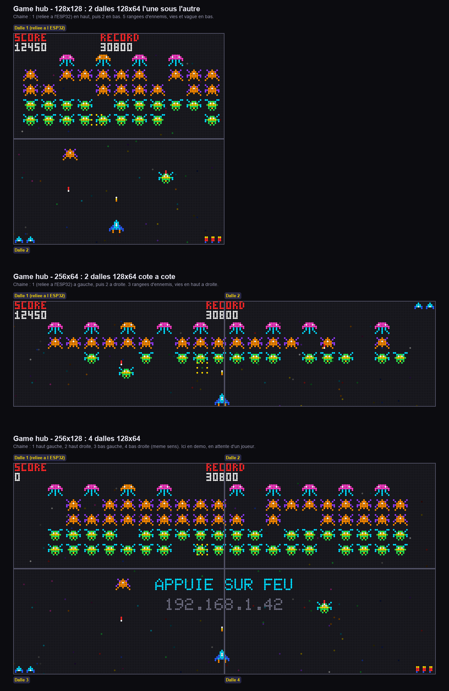
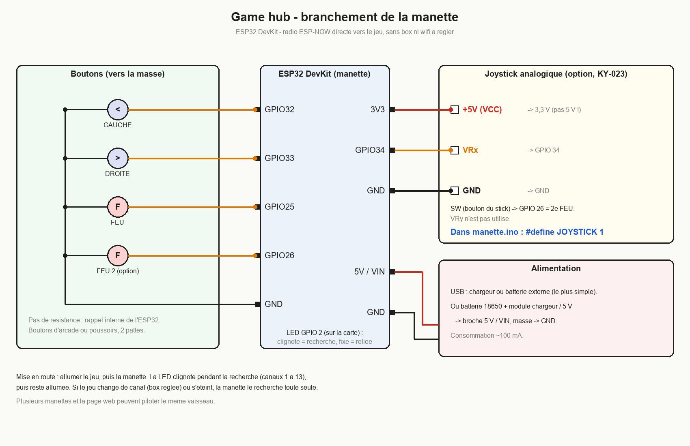

# Game hub : shoot'em up sur dalles LED HUB75 (ESP32)

Le shoot'em up du mode Jeu du VU-mètre, jouable de deux façons :
- depuis une **page web** (téléphone, tablette, PC) ;
- avec une **manette ESP32**, un 2ᵉ ESP32 avec des boutons qui parle directement au jeu par radio ESP-NOW. Il n'y a besoin ni de box ni de page web.



*Aperçu simulé (généré par `docs/rendu.py`, mêmes sprites que le jeu). Chaque configuration en grand : [128x128](docs/rendu-128x128.png), [256x64](docs/rendu-256x64.png), [256x128](docs/rendu-256x128.png).*

## Écrans

Choix dans la page web (Réglages → Écran). Le choix est gardé en mémoire et l'ESP32 redémarre.

| Écran | Dalles 128x64 | Montage (ordre de la chaîne) |
|---|---|---|
| 128x128 | 2 | l'une sous l'autre, la 1ʳᵉ (reliée à l'ESP32) en haut |
| 256x64 | 2 | côte à côte, la 1ʳᵉ à gauche |
| 256x128 | 4 | haut gauche → haut droite → bas gauche → bas droite, toutes dans le même sens |

Brochage identique à l'horloge ClockV1 et au VU-mètre.


La profondeur de couleur est choisie au démarrage : la plus haute qui laisse assez de mémoire au wifi, entre 6 et 3 bits. En 256x128, on aura probablement 3 bits. Si même 3 bits ne passe pas, l'ESP32 revient tout seul en 128x128.

## Jouer

1. **Wifi :** au démarrage, l'ESP32 essaie dans l'ordre :
   1. les réseaux de `games/secrets.h`, un fichier local jamais publié (il est dans .gitignore), même format que celui de l'horloge ;
   2. le dernier réseau réglé ;
   3. sinon, il crée le réseau **Games-Setup** pendant 3 min. Connecte-toi dessus et choisis ta box sur la page qui s'ouvre (sinon va sur 192.168.4.1). Pendant ce temps, le jeu et la manette ESP32 marchent déjà, et la dalle affiche `WIFI:Games-Setup`.
2. Ouvre **http://games.local**, ou l'adresse IP affichée sur la dalle pendant la démo.
3. Appuie sur **FEU** pour lancer une partie.

Commandes :
- **Tactile :** ◀ ▶ et **FEU**. Garder FEU appuyé tire en continu.
- **Clavier :** ← → ou Q / D pour bouger, espace pour tirer.
- **Manette :** une manette branchée au PC ou au téléphone est reconnue par le navigateur.

Sans joueur, le jeu tourne tout seul en démo. Une partie abandonnée repasse en démo après 1 min sans appui. Le record (des joueurs seulement) est gardé en mémoire.

Réglages de la page : luminosité et type d'écran.

**Bouton BOOT appuyé 5 s :** oublie le wifi et redémarre sur Games-Setup.

## Manette ESP32 (sans wifi ni box)

Sketch : [manette/manette.ino](manette/manette.ino). Il marche sur n'importe quel ESP32 classique (DevKit), avec des boutons vers la masse :

| Bouton | GPIO |
|---|---|
| Gauche | 32 |
| Droite | 33 |
| Feu | 25 |
| Feu (2ᵉ bouton, ou bouton du joystick) | 26 |
| LED de la carte | 2 : clignote = recherche du jeu, allumée = reliée |



En option, un joystick analogique (module KY-023) : axe X sur GPIO 34, alimenté en 3,3 V. Mets `#define JOYSTICK 1` dans manette.ino.

**Fonctionnement (ESP-NOW, la radio directe d'Espressif entre ESP32) :**
- Le jeu émet une balise 2 fois par seconde sur son canal wifi : celui de la box s'il y est connecté, sinon celui du réseau Games-Setup.
- La manette écoute les canaux 1 à 13 jusqu'à trouver cette balise. Elle envoie ensuite l'état de ses boutons à chaque appui et toutes les 100 ms, avec environ 1 ms de délai.
- Si le jeu ne répond plus pendant 3 s (jeu éteint, ou canal changé parce que la box a été réglée), la manette recommence sa recherche toute seule.
- Si la manette se tait plus de 0,5 s, le jeu relâche ses touches : le vaisseau ne reste pas bloqué.
- Plusieurs manettes et la page web peuvent être utilisées en même temps : elles pilotent le même vaisseau.

Pourquoi pas le Bluetooth : sa pile prend 50 à 100 Ko de RAM, ce qui ne tient pas avec la mémoire des dalles. ESP-NOW passe par la radio wifi déjà active et ne coûte presque rien.

## Firmware

Binaires prêts à flasher sur un ESP32 classique, à l'adresse 0x10000 :

| Fichier | Rôle | MD5 |
|---|---|---|
| [firmware/Games_V1.00.bin](firmware/Games_V1.00.bin) | le jeu, pour l'ESP32 des dalles | `81553beeffc47d9e5dc4a5f807cdd8ef` |
| [firmware/Manette_V1.00.bin](firmware/Manette_V1.00.bin) | la manette ESP-NOW | `598ccc714d7c450ee49a337ae10b483b` |

Le jeu publié ne contient aucun réseau wifi. Au premier démarrage, règle le wifi avec le réseau **Games-Setup**. Pour intégrer tes propres réseaux, crée `games/secrets.h` et recompile.

## Compilation

```powershell
./build.ps1           # le jeu et la manette -> Games_V<version>.bin et Manette_V<version>.bin
./build.ps1 games     # le jeu seulement
```

Avec arduino-cli, pour un ESP32 classique sur le core 2.0.17.

Plans et aperçus : `python docs/branchement.py` et `python docs/rendu.py` (Pillow).

Le script utilise les bibliothèques de l'horloge : ESP32-HUB75-MatrixPanel-I2S-DMA, Adafruit GFX, ESPAsyncWebServer, AsyncTCP et WiFiManager.

> Pas encore testé sur le matériel.
