# Game hub : jeux d'arcade sur dalles LED HUB75 (ESP32 + manette PS4)

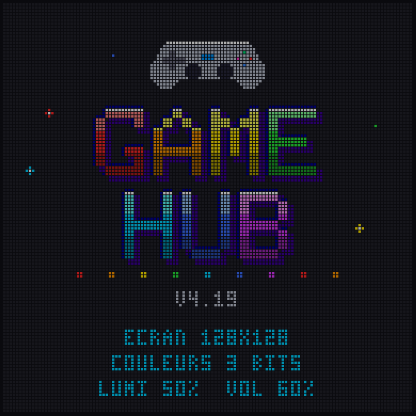

Au démarrage, le logo **GAMEHUB** (une manette, des lettres arc-en-ciel en dégradé) s'affiche 2 s avec la version et les réglages en cours. Il est **animé** (V4.19) : un reflet balaie les lettres, les étoiles scintillent, les perles changent de couleur et la dalle pulse doucement. En démo, à chaque changement de jeu : le **tableau des scores** du jeu qui finit (2 s), puis le logo avec le nom du jeu suivant (2 s).

Jeux d'arcade sur 1 à 4 dalles LED 128x64, avec un ESP32 classique et une **manette PS4 reliée en Bluetooth**.

- **Pas de wifi :** la manette se connecte directement à l'ESP32 des dalles.
- **Partition unique de 3 Mo :** il reste de la place pour d'autres jeux.
- **Son en option :** une broche PWM vers un petit ampli et un haut-parleur.

**18 jeux originaux** (16 dans le firmware actuel : BUNKER 3D et RENARD en sont retirés pour l'instant, leur code reste dans `games.ino`, voir `GAME_BUNKER` / `GAME_RENARD`), à choisir dans le menu (gauche / droite sur la ligne JOUER). Au démarrage, la démo part sur un **jeu tiré au hasard** (V4.33), et c'est ce jeu que le menu propose. Les noms affichés au menu se changent dans le tableau `GAME_NAME` en haut de `games/games.ino`.

Les 18 jeux ont en commun les niveaux de difficulté, les stages, les vies, les meilleurs scores avec les noms et la démo automatique.

## Les 18 jeux en un coup d'œil

Dans tous les jeux : 3 min sans toucher aux manettes, elles s'éteignent et la démo reprend (V4.26). Les jeux qui redessinent tout l'écran sont dessinés en mémoire puis envoyés d'un bloc : plus de LED qui clignote (V4.27).

Dans tous les jeux : **OPTIONS ou L2 = pause** ; en pause, **○ revient au menu** (le score est enregistré). Les deux manettes pilotent le menu. « Sans fin » : les stages continuent tant qu'il reste des vies ; la difficulté monte puis **plafonne** au stage indiqué.

| N° | Au menu | Jeu | Touches | Bonus | Niveaux |
|---|---|---|---|---|---|
| 0 | GALAGA | [SPACE DEFENDER](#space-defender) | gauche / droite (croix ou stick), **✕ tirer** | vaisseau qui évolue (tir rapide, double, triple canon) ; ennemis abattus en vol ×2 ; fin de stage 500 × stage ; boss 2000 × n° ; une vie par stage | sans fin ; 4 mondes en boucle ; boss tous les 4 stages ; difficulté plafonnée au stage 12 |
| 1 | SHOOTME | [RAID](#raid) | croix / stick : bouger, **✕ tirer**, **○ bombe** | capsules **P** (arme, jusqu'à 5 tirs), **S** bouclier, **B** bombe ; boss : 2000 × stage + une vie | sans fin ; boss après 8 vagues à chaque stage |
| 2 | PONG | [RAQUETTES](#raquettes) | haut / bas (stick : vitesse proportionnelle) | point gagné 100 × stage ; effet donné par la raquette | sans fin ; stage suivant tous les 5 points ; 3 points encaissés = fin (à deux : premier à 7) |
| 3 | BULLES | [BULLES](#bulles) | gauche / droite, **haut ou ○ sauter**, **✕ bulle** | cristal 500 ; bonus de chaîne ; boss 3000 × stage ; une vie par niveau | sans fin ; 4 niveaux par stage (le 4e : boss géant) ; 8 plans de plateformes, en miroir un stage sur deux |
| 4 | PAC MAN | [LABYRINTHE](#labyrinthe) | croix / stick, **✕ ou ○ sauter** par-dessus une créature | grosse graine : créatures bleues 200, 400, 800, 1600 ; créature sautée +100 ; une vie par stage | sans fin ; vitesse plafonnée au stage 8 |
| 5 | ORBITUS | [ORBITUS](#orbitus) | stick : glisser sur l'orbite, croix gauche / droite : tourner, **✕ tirer** | ennemis en piqué ×2 ; capsule de l'ennemi blanc : double tir ; une vie par stage | sans fin ; de 4 à 7 vagues (7 au stage 7) |
| 6 | CASSE BRIQUES | [CASSE BRIQUES](#casse-briques) | gauche / droite (stick proportionnel), **✕ lancer / tirer** | capsules : raquette large, balle lente, 3 balles, tir, vie, **porte** (5 s, sortie en bas à droite : stage suivant +2000) ; piège bleu : raquette réduite 10 s | 6 tableaux en boucle, sans fin ; vitesse de la balle plafonnée au stage 10 |
| 7 | TETRIS | [BLOCS](#blocs) | gauche / droite, **bas** accélère, **haut** chute directe, **✕ / ○ tourner** | 1 à 4 lignes : 100, 300, 500, 800 × niveau | niveau suivant toutes les 10 lignes ; vitesse maximale au niveau 12 ; une seule partie |
| 8 | CANDY CRUCH | [CRUCH](#cruch) | croix / stick : curseur, **✕ prendre**, direction : échanger, **○ annuler** | 4 alignés : bonbon rayé ; 5 : bombe ; chaînes ; coups restants ; une vie par niveau | sans fin ; objectif +700 points à chaque niveau |
| 9 | DIG DUG | [TAUPE](#taupe) | croix / stick, **✕ ou ○ jet de boue** | rocher qui écrase : gros bonus ; plus la créature est profonde, plus elle rapporte | sans fin ; jusqu'à 5 rochers ; vitesse plafonnée au stage 8 |
| 10 | BILLES | [BILLES](#billes) | gauche / droite : viser (stick direct), **✕ tirer** | billes qui tombent : gros bonus | sans fin ; **50 billes éclatées ou tombées par stage** (compteur à droite) ; de 4 à 6 couleurs (6 au stage 6) ; une seule partie |
| 11 | 1945 | [ESCADRILLE](#escadrille) | croix / stick, **✕ (□, R1, R2) tirer**, **○ tonneau** | capsules **P** arme (5 tirs), **T** tonneau, **+** vie ; boss 2000 × stage | sans fin ; boss après 10 vagues (3 avions chacun son tour) |
| 12 | BUNKER 3D | [BUNKER 3D](#bunker-3d) | stick gauche : avancer / pas de côté, stick droit : pivoter, L1 / R1 pas de côté, **✕ / R2 tirer**, **□ ouvrir**, **○ arme**, **△ carte** | soin, munitions, armure, carte rouge, arme lourde ; combos DOUBLE, TRIPLE, CARNAGE ; barils en chaîne | sans fin ; un nouveau bunker généré à chaque stage |
| 13 | TURBO ROUTE | [TURBO ROUTE](#turbo-route) | gauche / droite : braquer, **✕ / R2 / haut accélérer**, **bas freiner**, stick droit : accélérer / freiner, **○ turbo** | pièce 250 ; voiture doublée 50 ; bidon de turbo ; police semée 2000, police KO 3000 ; secondes restantes × 100 | sans fin ; 4 décors en boucle ; distance plafonnée au stage 6, circulation au stage 8 |
| 14 | RENARD | [RENARD](#renard) | **✕ ou haut sauter** (tenir : plus haut), **bas se baisser** (en l'air : retomber vite) | gemme +100 ; étoile : invincible 5 s (traverse tout, +50 par obstacle) | sans fin ; stage tous les 1000 points ; vitesse maximale atteinte peu à peu ; jour et nuit en alternance |
| 15 | PAC MANIA | [SCARABEE 3D](#scarabee-3d) | croix / stick, **✕ ou ○ sauter** | comme LABYRINTHE (grosse graine, créatures 200 à 1600, créature sautée +100) | sans fin ; couleurs du décor différentes à chaque stage ; vitesse plafonnée au stage 8 |
| 16 | RALLYE 3D | [RALLYE 3D](#rallye-3d) | **croix / stick : direction à l'écran** (la voiture y va et accélère), **✕ / R2 accélérer**, **○ freiner**, stick droit : accélérer / freiner | tour bouclé 500 ; balise 10 ; arrivée : 1000 × stage × (5 − place) | sans fin ; 3 tours contre 3 adversaires, finir dans les 3 premiers pour passer (**les 2 premiers dès le stage 3**, sauf en facile) ; 4 décors en boucle, circuit en miroir un stage sur deux ; adversaires plus rapides jusqu'au stage 7 ; **2 joueurs** (écran commun) |
| 17 | VORTEX 3D | [VORTEX 3D](#vortex-3d) | gauche / droite (stick), **haut / bas : vitesse**, **✕ tirer**, **○ sauter** | caisse 50, mine 30, soucoupe 300, orbe 200 (double tir 10 s) ; fin de stage 1000 × stage | sans fin ; une distance par stage ; trous dans la route à partir du stage 2 ; vitesse et obstacles plafonnés au stage 8 |


## Deux manettes (Bluepad32)

Depuis la V3.84, le Game-hub utilise **Bluepad32** : jusqu'à **4 manettes Bluetooth** en même temps (PS3, PS4, PS5, Xbox, Switch Pro...).

- **Menu « JOUEURS 1 / 2 »** (2e ligne, une étoile par manette connectée) : seuls les jeux à deux joueurs utilisent la 2e manette.
  - **RAQUETTES** : match à deux (raquette de droite pour le joueur 2), **le premier à 7 points gagne**.
  - **SPACE DEFENDER** : coopération, un 2e vaisseau **vert** pour le joueur 2, vies et score communs ; les ennemis piquent sur l'un ou l'autre ; la manette du joueur touché vibre.
- **Mise à jour depuis la V3.70 ou avant** : flasher une fois `firmware/GameHub_V4.35_complet.bin` à **0x0** (le démarrage change), puis réassocier les manettes (voir « Manettes » plus bas).
- **Mémoire** : environ 81 Ko libres avec 2 dalles en 3 bits et deux manettes connectées.

# SPACE DEFENDER

Le jeu principal : un shoot'em up original, repris du mode Jeu du VU-mètre. Une formation d'ennemis arrive en vol, change de monde à chaque stage, et ton vaisseau évolue.


*Aperçu simulé, généré par `docs/rendu.py` avec les mêmes sprites que le jeu. Chaque configuration en grand : [128x128](docs/rendu-128x128.png), [256x64](docs/rendu-256x64.png), [128x256](docs/rendu-128x256.png).*


- **Écran :** le **score centré en haut**, sur une ligne. Le record n'est plus affiché pendant le jeu : il est dans le menu et sur la page des scores. Les **vies** sont en haut à droite, avec une petite icône par vie (au-delà de 5 : une icône et le nombre). C'est pareil dans tous les jeux . Le vaisseau est tout en bas de l'écran. Le stage s'affiche dans l'annonce, au début de chaque stage.
- **Vies :** Chaque stage terminé donne **une vie de plus** (9 au maximum). Après une vie perdue, le nouveau vaisseau est **invincible 4 secondes** (il clignote).
- **Stages, sans fin :** quand tous les ennemis sont détruits, l'annonce « STAGE n » s'affiche avec le nom du monde et un bonus de 500 points × le numéro du stage.
  - Les ennemis tirent plus souvent à chaque stage, et leurs tirs vont plus vite.
  - Leurs piqués sont de plus en plus fréquents, jusqu'au stage 7 environ.
- **Un nouveau monde à chaque stage**, en boucle : de nouveaux ennemis, avec de nouveaux déplacements ou de nouvelles défenses. Les ennemis sont des sprites originaux multicolores : méduse, papillon et guêpe (Nébuleuse), crabe, mante et araignée (Crabes), fleur de cristal, soucoupe et raie (Cristaux), orbe et araignée à cornes (Orbes). Le vaisseau de base est un chasseur blanc et rouge au cockpit bleu.

  

  | Stages | Monde | Comportement |
  |---|---|---|
  | 1, 5, 9… | Nébuleuse | piqués en boucle |
  | 2, 6, 10… | Crabes | formation qui balance plus vite et plus large, piqués **à deux** |
  | 3, 7, 11… | Cristaux | **un tir de plus** pour chaque ennemi, piqués **en zigzag** |
  | 4, 8, 12… | Orbes | la formation **descend et remonte**, et leurs tirs **visent ton vaisseau** |
- **Les méduses de la rangée du haut**, les plus rares, demandent 2 tirs. Détruites, elles **éclatent en 4 petits vaisseaux** qui plongent aussitôt vers toi, et qui replongent du haut de l'écran tant qu'ils ne sont pas abattus.
- **Formation :** 10 ennemis par rangée sur une dalle de 128 de large. Il reste de la place sur les côtés, alors l'essaim se balance bien de droite à gauche.
- **Difficulté adoucie (V3.93) :** piqués moins fréquents, tirs ennemis moins nombreux et moins rapides ; la difficulté monte doucement et plafonne au stage 12. Boss un peu moins résistant, salves plus espacées.
- **Boss tous les 4 stages (4, 8, 12…) :** une fois la formation détruite, un grand vaisseau-mère arrive en haut de l'écran. Il va et vient et tire en éventail, et sa barre de vie s'affiche sous le score.
  - **2e phase :** sous la moitié de sa vie, il devient rouge et tire plus souvent, en éventail de 5.
  - **Quand tu le casses :** gros bonus (2000 × numéro du boss), puis il **éclate en 5 petits vaisseaux qui plongent aussitôt vers toi**. Il faut les détruire pour passer au stage suivant.
  - Il est plus résistant à chaque nouveau boss, et selon le niveau choisi (facile, normal, difficile).
- **Arrivée en vol :** les ennemis arrivent en files, par groupes en miroir. Ils suivent des trajectoires courbes avec des boucles, puis rejoignent leur place. Abattus en vol, ils rapportent **double**.

  

- **Le vaisseau évolue à chaque stage :**

  

  | Stage | Vaisseau |
  |---|---|
  | 1 | de base, un tir |
  | 2 | **tir rapide** (ailes vertes) |
  | 3 | **double canon**, deux tirs parallèles |
  | 4 et + | **triple canon**, tirs en éventail |

- **Abandon :** une partie sans aucun appui pendant 1 min repasse en démo.

# Les autres jeux

### RAID

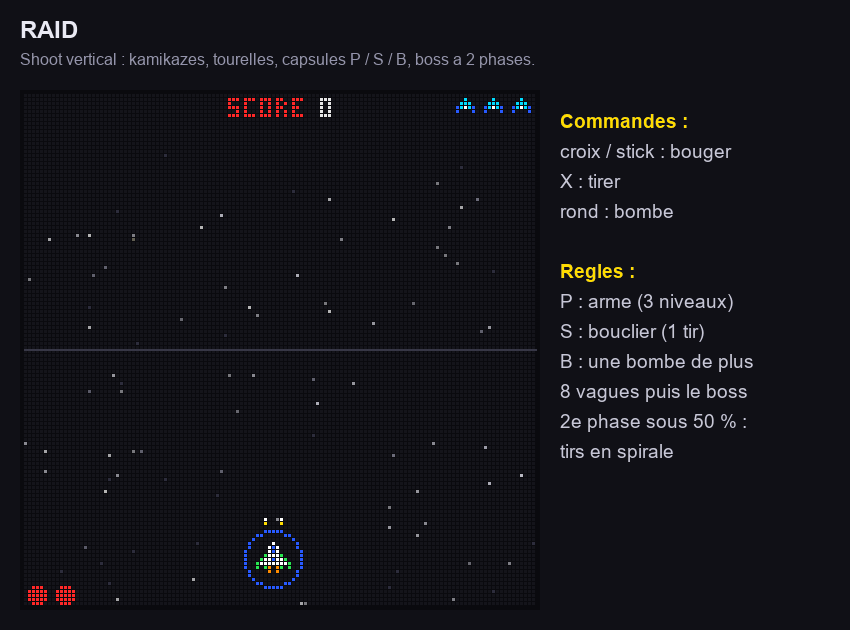

Un shoot vertical : tu te déplaces partout dans le bas de l'écran, et les vagues d'ennemis descendent.
- **Commandes :** croix ou stick pour bouger, ✕ pour tirer (en continu si tu restes appuyé), **○ pour une bombe**.
- **Ennemis :**
  - des lignes et des diagonales ;
  - des éventails ;
  - des **kamikazes**, qui foncent sur ton vaisseau ;
  - des **tourelles**, qui s'arrêtent en haut et tirent en éventail.

  Touchés, ils clignotent en blanc.
- **Capsules** (une icône dans un cadre qui clignote) :
  - **double flèche jaune** : améliore l'arme, sur 3 niveaux, jusqu'à 5 tirs en éventail. Perdre une vie fait baisser l'arme d'un niveau.
  - **bouclier cyan** : donne un bouclier, qui encaisse un tir.
  - **bombe rouge** : ajoute une bombe. Les bombes restantes s'affichent en bas à gauche.
- **Bombe (○) :** elle détruit les ennemis à l'écran, efface leurs tirs et blesse le boss.
- **Boss (V3.93) :** après 8 vagues, **le même vaisseau-mère que dans le 1er jeu**, en double taille, avec sa barre de vie en haut. Il se balance et tire en éventail (3 tirs, puis 5 sous la moitié de sa vie, coque rouge) ; touché, il devient blanc. Détruit, il **éclate en 5 petits vaisseaux** qui plongent sur toi.
  - Le détruire termine le stage : gros bonus et une vie en plus.

### BULLES

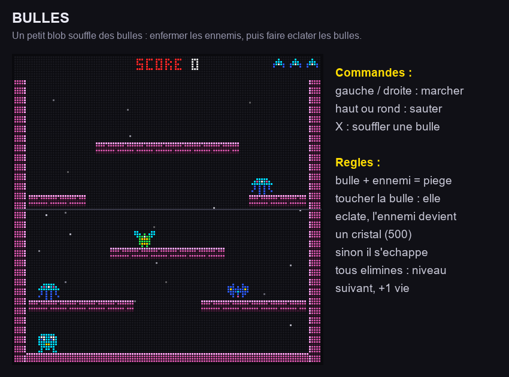

Un petit blob cyan original souffle des bulles, sur un écran de plateformes différent à chaque niveau.
- **Niveaux et stages (V4.20) :** 4 niveaux par stage (affichés 1-1, 1-2...), 8 plans de plateformes dessinés, en miroir un stage sur deux ; couleur des plateformes et ennemis différents à chaque stage ; plus d'ennemis et plus rapides au fil des niveaux.
- **Boss :** au 4e niveau de chaque stage, un monstre géant rebondit dans l'arène (barre de vie en haut). Chaque bulle qui le touche lui enlève de la vie ; à partir du stage 2 il crache des boules de feu. Vaincu, il est pris dans une bulle géante : touche-la pour la faire éclater (3000 × stage et pluie de cristaux).
- **Sans scintillement :** l'image est dessinée en mémoire puis envoyée d'un bloc (32 Ko pendant le jeu seulement). « VITE ! » s'affiche quand les ennemis s'énervent.
- **Le décor :** murs de 5 pixels et plateformes épaisses en briques, avec une arête claire et des joints, aux couleurs du niveau.
- **Commandes :** gauche / droite pour marcher, **haut ou ○ pour sauter**, **✕ pour souffler une bulle**. On traverse les plateformes par-dessous en sautant, et on retombe dessus.
- **Piéger un ennemi :** une bulle qui touche un ennemi l'**enferme**, puis monte vers le plafond. **Touche la bulle** pour la faire éclater : l'ennemi devient un **cristal** qui tombe, et le ramasser rapporte 500 points. Éclater plusieurs bulles à la suite donne un bonus de chaîne.
- **Attention :** une bulle qui clignote en rouge va éclater toute seule, et l'ennemi s'échappe, en colère et plus rapide. Au bout de 40 s, tous les ennemis s'énervent.
- **Les ennemis :** ceux des mondes de SPACE DEFENDER. Certains marchent et sautent d'étage en étage, et à partir du niveau 2, les insectes volent en diagonale.
- **Niveau gagné :** tous les ennemis sont éliminés. Tu passes à un nouveau plan, avec plus d'ennemis, et tu gagnes une vie en plus.

### LABYRINTHE

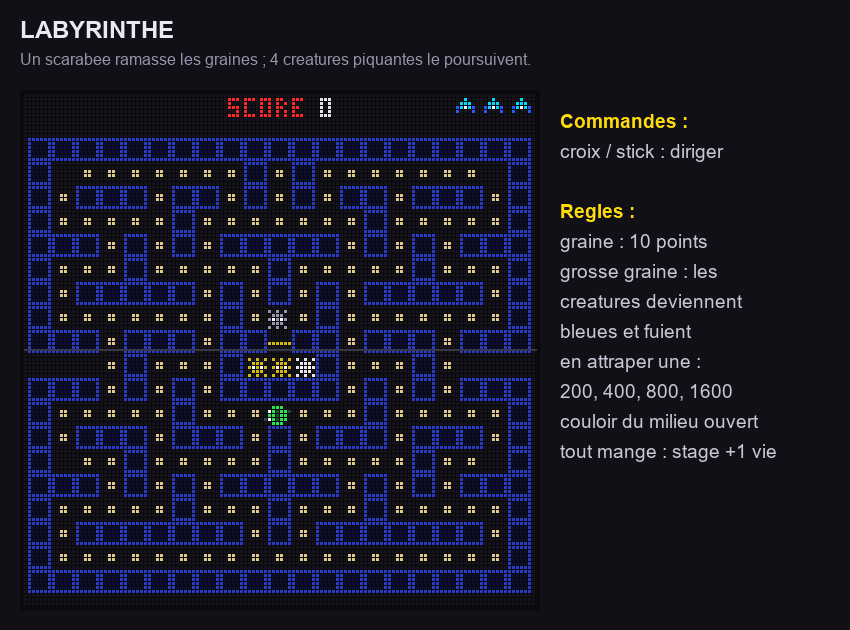

Un petit scarabée vert ramasse toutes les graines d'un labyrinthe original, poursuivi par 4 créatures piquantes.
- **Vies :** petites créatures piquantes en haut à droite, chacune d'une couleur différente (6 couleurs).
- **Sur une seule dalle (128x64)**, le labyrinthe garde des cases de 6 pixels et **défile verticalement** pour suivre le scarabée. Il tient en entier à partir de 128x128.
- **Graphisme :** murs « néon » aux coins arrondis (couleur différente à chaque stage), grosses graines qui pulsent, créatures aux piquants qui tournent et aux yeux qui regardent où elles vont, scarabée avec carapace, reflet, tête et pattes qui bougent.
- **Commandes :** croix ou stick pour diriger le scarabée. La direction choisie est gardée jusqu'au prochain croisement possible.
- **Saut (V4.12) :** **✕ ou ○** : le scarabée saute par-dessus une créature (+100), son ombre reste au sol ; petit délai avant de ressauter. En démo, il saute tout seul quand une créature arrive.
- **Les créatures :** chacune a son caractère.
  - La violette fonce droit sur toi.
  - L'orange vise devant toi.
  - La verte essaie de te prendre en tenaille.
  - La blanche, timide, repart dans son coin quand elle est trop près.
- **Grosse graine lumineuse :** pendant quelques secondes, les créatures deviennent **bleues** et fuient. En attraper une rapporte 200, 400, 800 puis 1600 points, et elle retourne à sa maison.
- **Couloir du milieu :** il est ouvert sur les deux côtés. Sortir d'un côté fait ressortir de l'autre.
- **Stages :** tout manger fait passer au stage suivant. Les créatures sont plus rapides, les murs changent de couleur, et tu gagnes une vie.

### ORBITUS


Ton vaisseau **tourne sur le bord de l'écran** et tire **vers le centre**. Les étoiles jaillissent du centre, ce qui donne de la profondeur.
- **Commandes :** pousse le stick dans une direction, et le vaisseau **glisse sur son orbite** jusque-là. Avec la **croix numérique**, gauche / droite le font **tourner en continu** (tour complet), haut / bas / diagonales l'envoient vers cette direction. ✕ (ou carré, triangle, R1, L1, R2) pour tirer en continu.
- **Les ennemis :** ils sortent du centre **en spirale**, se rangent en anneau, puis **plongent vers toi** en tirant. Ils grossissent en approchant : un point au loin, une petite croix, puis le sprite.
- **Couleurs :** de près, les ennemis sont des sprites en couleurs (méduse, soucoupe, papillon, satellite) ; leurs couleurs **changent à chaque stage** (4 jeux de couleurs). Ton vaisseau a des bords cyan, des feux rouges au bout des ailes et un réacteur qui scintille.
- **Points :** 50, 80 ou 100 selon l'ennemi, **doublés s'il est en piqué**.
- **Ennemi blanc :** il lâche une capsule. Rattrape-la sur ton orbite pour avoir le **double tir**, jusqu'à la prochaine vie perdue.
- **Stages :** 4 vagues de 8 ennemis au stage 1, puis une vague de plus tous les 2 stages (jusqu'à 7 vagues, 56 ennemis). Tout détruire fait passer au stage suivant, avec un **saut en hyperespace** (les étoiles accélèrent). Les ennemis piquent plus souvent, et tu gagnes une vie.

### RAQUETTES


Une balle et deux raquettes, **à l'horizontale** : la tienne à gauche, celle de l'ordinateur à droite.
- **Commandes :** haut / bas pour déplacer ta raquette. Avec le **stick analogique**, elle va d'autant plus vite que tu le pousses loin.
- **La balle :** son angle dépend de l'endroit où elle touche la raquette, et elle accélère à chaque échange. Elle rebondit en haut et en bas.
- **Raquettes** (V3.85) : en relief sur 3 colonnes (ombre côté mur, couleur, reflet côté balle), bouts arrondis, poignée au milieu ; elles **s'éclairent en blanc** quand la balle les touche. 10 pixels de haut sur une dalle 128x64, 16 en 128x128.
- **Effet :** une raquette qui bouge au moment du contact donne de l'effet à la balle (elle part plus en haut ou plus en bas).
- **Points :** un point gagné rapporte 100 × le stage. Près du filet : tes points du stage (cyan) à gauche, ceux de l'ordinateur (rouge) à droite. Au 3e point de l'ordinateur, la partie est finie (pas d'icônes de vies en haut).
- **Stages :** 5 points gagnés font passer au stage suivant. L'ordinateur devient plus rapide, les raquettes un peu plus petites.
- **À deux manettes :** menu JOUEURS 2, la 2e manette tient la raquette de droite ; le premier à 7 points gagne.

### CASSE BRIQUES


Un casse-briques original. Une raquette en bas renvoie la balle vers un mur de briques.
- **Briques en relief (V3.93) :** arête claire en haut, bord gauche éclairé, bord droit et dessous dans l'ombre, reflet brillant et ombre portée ; un éclat passe sur les briques d'argent et d'or, une fissure apparaît sur l'argent abîmé.
- **Vies :** de petites balles blanches en haut à droite.
- **Commandes :** stick ou croix gauche / droite pour la raquette (au **stick**, elle va d'autant plus vite que tu le pousses loin), **✕ pour lancer la balle**.
- **Briques :** de couleur (1 coup, plus elles sont hautes plus elles rapportent), **d'argent** (2 coups, 3 à partir du stage 6) et **d'or** (incassables, à partir du stage 4). Chaque brique a un reflet et une ombre.
- **Capsules :** une brique cassée lâche parfois une capsule qui tombe. Cyan : **raquette large**. Orange : **balle lente**. Magenta : **3 balles**. Jaune : **tir** (15 s : deux canons au bout de la raquette, ✕ tire vers les briques). Rouge : **une vie**. Verte : **porte** (V4.12) : une sortie s'ouvre en bas à droite **pendant 5 s** (elle clignote vite avant de se refermer) ; pousse la raquette contre le bord droit pour sortir : stage suivant et +2000. Bleue : **piège**, la raquette rétrécit 10 s (-100).
- **Raquette :** trois rangées en dégradé avec un reflet, embouts rouges arrondis, centre cyan qui pulse.
- **Tableaux :** 6 dessins (mur plein, damier, pyramide, losange, rangées avec argent, motif) qui reviennent en boucle. Tout casser (sauf l'or) fait passer au suivant, avec une balle plus rapide et une vie en plus.

### BLOCS

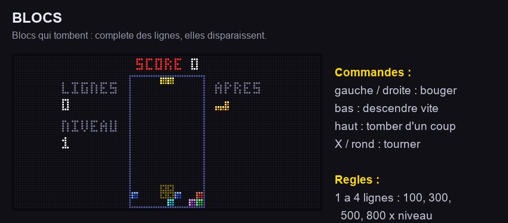

Des blocs qui tombent, à empiler pour compléter des lignes.
- **Commandes :** gauche / droite pour déplacer la pièce (en gardant appuyé, elle glisse), **bas** pour descendre plus vite, **haut** pour la faire tomber d'un coup, **✕** pour la tourner dans un sens, **○** dans l'autre.
- **À l'écran :** blocs en relief (reflet, ombre), **pièce fantôme** qui montre où la pièce va tomber, pièce suivante à droite, lignes et niveau à gauche.
- **Points :** 1, 2, 3 ou 4 lignes d'un coup : 100, 300, 500 ou 800 × le niveau. Les lignes complètes clignotent puis disparaissent.
- **Niveaux :** toutes les 10 lignes, les pièces tombent plus vite. **Une seule partie** (pas de vies) : si la pile atteint le haut, la partie est finie.

### TAUPE


Un jeu de creusage original : une taupe creuse ses galeries sous terre (4 couches de terre de couleurs différentes).
- **Commandes :** croix ou stick pour se déplacer (creuser ralentit), **✕ ou ○ : jet de boue** (3 cases devant).
- **Les créatures :** des vers roses qui suivent les galeries, et des chauves-souris qui traversent parfois la terre (on ne voit que leurs yeux).
- **Jet de boue :** une créature touchée est **assommée** (elle clignote) ; touchée une 2e fois, elle **éclate**. Plus elle est profonde, plus elle rapporte.
- **Rochers :** creuser sous un rocher le fait trembler puis **tomber** : il écrase les créatures (gros bonus)… et la taupe si elle est dessous.
- **Stages :** toutes les créatures éliminées : stage suivant, avec plus de créatures et de rochers.

### BILLES

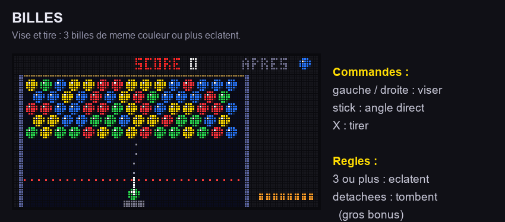

Un jeu de tir de billes original, dans un puits.
- **Commandes :** gauche / droite pour viser (au **stick**, l'angle suit directement le stick), **✕ pour tirer**. Des pointillés montrent la trajectoire, rebonds compris.
- **Écran :** le puits prend toute la largeur ; « APRÈS » et la bille suivante sont en haut à droite, sur la ligne du score ; 4 couleurs dès le 1er stage (dont le bleu).
- **Règles :** la bille rebondit sur les murs et se colle à la grappe. **3 billes de même couleur ou plus éclatent** ; celles qui ne tiennent plus au plafond **tombent** (gros bonus).
- **Plafond :** il descend d'un rang **tous les 8 tirs** (les marques orange en bas à droite). Une bille qui dépasse la ligne rouge : partie finie (une seule partie, pas de vies).
- **Stages :** tout vider fait passer au suivant, avec plus de rangées et plus de couleurs.

### ESCADRILLE

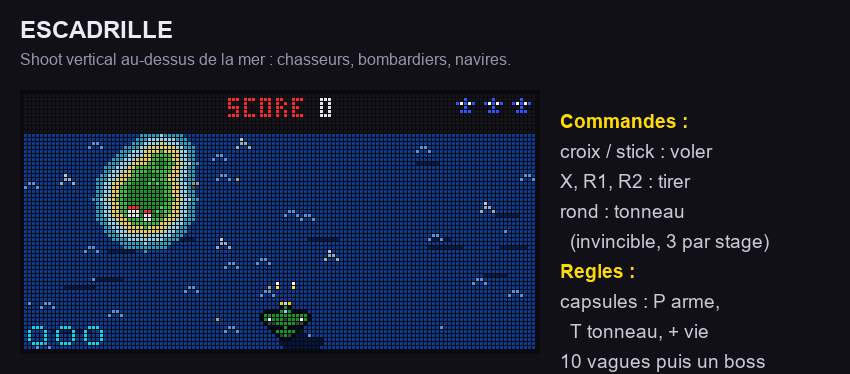

Un shoot vertical original au-dessus de la mer (V3.85, remplace ESCALADE ; nouveaux sprites et fond marin en V3.86, décor enrichi en V3.87).
- **4 ambiances (V4.30), une par stage en boucle :** tropiques, **banquise** (mer turquoise, blocs de glace), **volcans** (mer de nuit, îles de cendre, couronne de lave, cratère qui rougeoie), **crépuscule** (mer violette, crêtes orange, plages dorées).
- **Décor :** la mer défile avec sa houle, ses crêtes, ses moutons d'écume et des reflets du soleil (pas de vagues sur les îles) ; des îles de formes variées avec lagon en deux tons, plage, prairie, forêt, palmiers, maisons au toit rouge et rochers. Rien ne déborde sur la ligne du score.
- **Commandes :** croix ou stick pour voler dans le bas de l'écran, **✕ (ou carré, R1, R2) pour tirer**, **○ pour un tonneau** : l'avion tourne sur lui-même, il est invincible pendant 1 s mais ne tire pas. 3 tonneaux par stage (les ronds cyan en bas à gauche).
- **Boss (V3.98) :** deux avions qui alternent selon le stage : un **bombardier lourd à 4 moteurs** (liseré rouge) et un **bimoteur à double queue** (liseré jaune), en métal argenté avec contour, reflets, verrière et **hélices qui tournent**.
- **Navires (V3.99) :** coque en relief (bord éclairé, bord dans l'ombre, bastingage, ombre portée), passerelles vitrées, **radars qui tournent**, cheminées à bande rouge, canots orange ; porte-avions au pont gris avec axe jaune, piste en biais, ascenseur et îlot.
- **Mer plus sombre et îles sans clignotement (V3.97) :** les sprites ressortent mieux ; l'île n'est plus effacée à chaque image. Couleurs choisies pour rester visibles sur une dalle à 3 bits.
- **Hélices qui tournent (V4.02)** sur ton avion, les chasseurs et les bombardiers ; tes tirs en trait blanc et jaune.
- **Dalle à 3 ou 4 bits (V4.01) :** toutes les couleurs de 1945 évitent le niveau le plus faible (qui scintille ou disparaît). Mer unie : bleu d'origine en 3 bits (V4.05), bleu nuit en 4 bits.
- **Ton avion :** un chasseur **vert foncé** à étoiles blanches (V3.93 ; les chasseurs ennemis sont rouge brique), hélice qui tourne, avec un **contour sombre** et une **ombre sur la mer** pour bien le voir. Les avions ennemis ont aussi leur ombre.
- **Ennemis :** des chasseurs (rouge brique, argent ou jaunes) en V, en vague sinueuse, par le côté ou en piqué ; des **bombardiers bimoteurs** qui tirent en éventail ; des **navires** qui avancent sur la mer (vague d'étrave, sillage d'écume, tourelles qui suivent ton avion) : vedette, destroyer à cheminées qui fument, et **porte-avions** (pont gris, îlot, avions posés) qui fait décoller des chasseurs.
- **Capsules :** **P** jaune = arme (2, 3, 4 puis 5 tirs en éventail), **T** bleue = un tonneau de plus, **+** rouge = une vie (laissée par le porte-avions). Une vie perdue fait baisser l'arme d'un niveau.
- **Boss :** après 10 vagues, chacun son tour (V4.23, d'après des dessins fournis) : **bimoteur rouge à double poutre**, **grand quadrimoteur kaki** (ailes en dégradé, cocardes, capots cerclés de rouge), **aile volante bleue** aux moteurs jaunes, chacun avec ses grandes hélices qui tournent ; il glisse sans à-coups de gauche à droite ; il tire peu (éventail de 3 balles et un tir visé de temps en temps) ; sous la moitié de sa vie, il bouge plus vite, tire en éventail de 5 et en spirale lente.
- **Points :** chasseur 100, piqueur 150, vedette 300, bombardier 500, destroyer 600, porte-avions 1500, boss 2000 × le stage.

### BUNKER 3D

*Retiré du firmware depuis la V4.26 (`#define GAME_BUNKER 0` en haut de `games.ino` ; mettre 1 pour le remettre).*

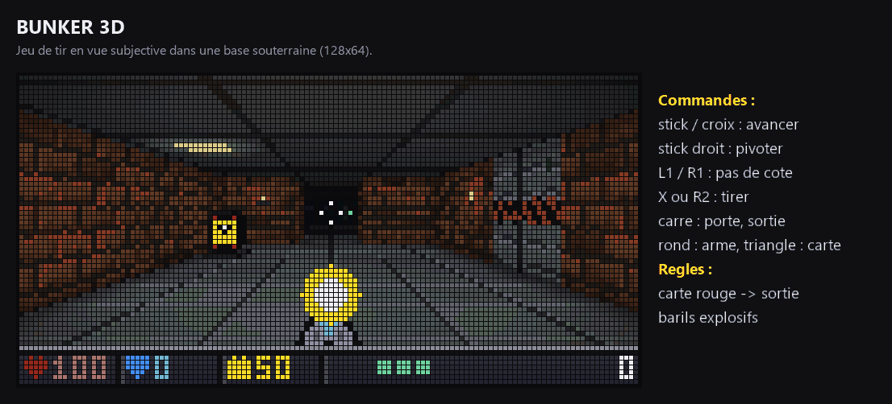

Un jeu de tir original **en vue subjective** (V3.88) : tu avances dans une base souterraine comme si tu y étais.
- **Moteur 3D** (lancer de rayons, calculé colonne par colonne, sans effacement donc sans scintillement) : murs texturés calculés à pleine résolution, sol en dalles et plafond avec plafonniers en perspective, brouillard avec la distance, ombre en haut et en bas des murs et le long des murs au sol, balancement de la marche.
- **Dalle à 3 ou 4 bits de couleur (V3.95) :** rendu adapté automatiquement : briques à teintes franches sans grain, sol et plafond assez clairs pour ne pas tomber au noir, peu de brouillard, robots éclairés. (La bibliothèque des dalles applique une courbe de luminosité avant de garder 3 bits : toute teinte sous ~100 devenait noire.)
- **Murs :** briques bleues en relief (V3.91 : dans toutes les salles), arêtes éclairées, joints sombres, certaines briques noircies, appliques lumineuses avec halo ; portes coulissantes à bandes jaunes, porte rouge fermée à clé, panneau de sortie vert.
- **Commandes :** stick gauche (ou croix) pour avancer, reculer et faire un pas de côté, **stick droit** (ou croix gauche / droite) pour pivoter, **L1 / R1** pas de côté, **✕ ou R2 tirer**, **□ ouvrir une porte / actionner la sortie**, **○ changer d'arme**, **△ mini-carte**. L2 ou OPTIONS : pause.
- **Ennemis (robots originaux dessinés en 24 × 24, V3.89) :** drone flottant à l'œil rouge rond (rotor qui tourne, bras-canons, flamme du réacteur), sentinelle à visière cyan et canons d'épaule, colosse blindé (casque, épaulières, poings) qui frappe au contact. **Volume** (bord éclairé, bord dans l'ombre, lumière du plafond), **ombre au sol**, éclairés par le plasma et les explosions ; leurs yeux et voyants brillent dans le noir. Les épaves **fument**.
- **Ils se défendent :** ils te repèrent quand ils te voient, ouvrent les portes et te poursuivent ; **ils esquivent** par des pas de côté quand tu les vises, **ripostent** dès qu'ils sont touchés et **préviennent leurs voisins** ; blessés, **ils reculent en tirant** ; ils gardent leurs distances. La sentinelle tire en **rafales de 3** puis se décale, le drone **vise là où tu vas être** et louvoie, le colosse **charge en zigzag**.
- **Toujours en mouvement (V3.89) :** avant de te voir, ils **patrouillent** dans leur salle ; au combat ils **tournent autour de toi** et changent de sens, ne se marchent pas dessus, **reculent sous l'impact**, et ceux que tu manques de peu font un pas de côté. **Le colosse se protège** : de loin, ta balle ricoche en bleu (moitié des dégâts), il n'est vraiment vulnérable qu'en chargeant.
- **Sensations (V3.89) :** la vue **tremble** sur les explosions et quand tu es touché, l'écran **rougit du côté d'où vient le tir**, le **viseur devient rouge** quand tu touches et **s'ouvre en jaune** quand tu détruis, débris qui volent, **combos** (DOUBLE, TRIPLE, CARNAGE : points en bonus), l'arme **recule** et s'éclaire à chaque tir.
- **Lumières :** le plasma éclaire en vert les murs et le sol, les explosions en orange, ton tir réchauffe la pièce ; étincelles quand tu touches un mur ; bords de l'image légèrement assombris.
- **Barils explosifs :** un tir les fait sauter ; l'explosion détruit les robots autour (et te blesse si tu es trop près), et fait sauter les barils voisins en chaîne.
- **Objets :** soin (+30), munitions (+25), armure (+50, encaisse la moitié des dégâts), **carte rouge** (ouvre la porte rouge et actionne la sortie), arme lourde (3 tirs en éventail, 3 munitions).
- **Stages :** chaque stage est un nouveau bunker (salles reliées par des couloirs et des portes), avec plus de robots. Barre du bas (dégradé métal, cases séparées) : vie, armure, munitions avec **jauges** (la vie passe du vert au rouge, écran 128x128), carte, vies, score.

### TURBO ROUTE

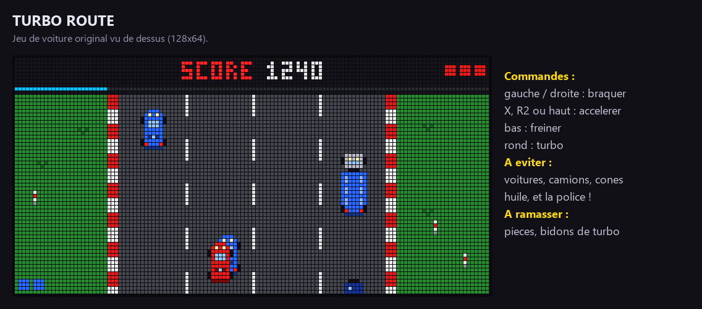

Un jeu de voiture original vu de dessus (V3.94) : tu doubles voitures et camions sur une route à 3 ou 4 voies.
- **Commandes :** gauche / droite pour braquer (au **stick**, braquage proportionnel), **✕, R2 ou haut accélérer**, **bas freiner**, **stick droit : haut accélère, bas freine** (proportionnel, V4.00), **○ turbo** (flammes, vitesse maximale plus haute).
- **Chrono (V4.00) :** un temps à respecter pour atteindre l'arrivée (en haut à droite, bip dans les 10 dernières secondes) ; **distance restante en km** en haut à gauche, **vitesse en km/h** en bas à droite, **ligne d'arrivée en damier**. Temps écoulé : une vie (le chrono repart) ; chaque seconde restante à l'arrivée : +100.
- **Graphismes (V4.00) :** voitures en relief avec ombre sur la route, ta voiture à bande blanche et aileron, traces de pneus et lignes de bord, arbres ronds, traits de vitesse au turbo.
- **Chocs (V4.04) :** percuter **l'arrière** d'une voiture ou d'un camion coûte une vie ; un contact **sur le côté** te repousse et te ralentit 1 s.
- **À éviter :** voitures et camions (qui changent de voie avec leur clignotant à partir du stage 2), **cônes**, **taches d'huile** (tête-à-queue). Le bas-côté secoue et freine.
- **À ramasser :** **pièces** (+250) et **bidons bleus** de turbo (3 au plus, en bas à gauche). Chaque voiture doublée : +50.
- **Poursuite :** une fois par stage, **la police surgit par l'arrière**, gyrophare rouge et bleu et sirène. Elle est un peu plus rapide que toi et se cale sur ta voie pour te percuter : tiens **15 s** (« SEMEE ! +2000 »), ou fais-la percuter une voiture, un camion ou un cône que tu viens de doubler (« POLICE KO +3000 »). Le turbo te permet de la distancer.
- **Stages :** une distance à parcourir (barre bleue sous le score) ; le décor change : **campagne, désert** (cactus), **neige** (sapins), **nuit** (réverbères, faisceau des phares). Plus de circulation à chaque stage.
- **Son :** **bruit de moteur** qui monte avec la vitesse (et le turbo), crissement sur l'huile, grondement sur le bas-côté, sirène de la police.
- **Grand écran (128x128 et plus) :** tout est dessiné en double taille.

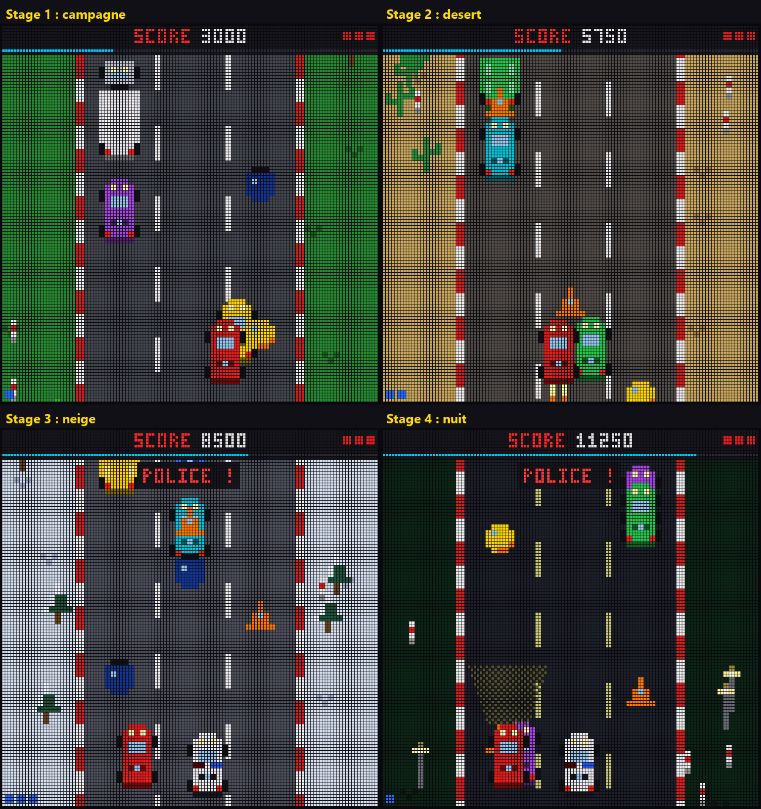

### RENARD

*Retiré du firmware depuis la V4.26 (`#define GAME_RENARD 0` en haut de `games.ino` ; mettre 1 pour le remettre).*

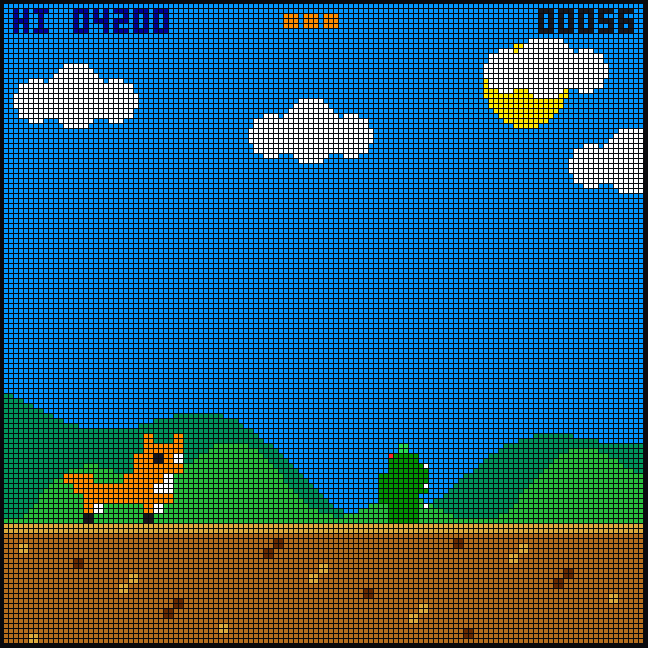

Une course sans fin originale (V4.11) : un petit renard orange court tout seul, le décor défile, et toi tu le fais sauter et se baisser.
- **Commandes :** **✕ ou haut pour sauter** (garder appuyé : saut plus haut), **bas pour se baisser** (en l'air : il retombe plus vite).
- **Obstacles :** rochers, buissons épineux (seuls ou en groupes de 2 ou 3), troncs couchés et, à partir du stage 2, des **chauves-souris** : basses (sauter), à mi-hauteur (se baisser) ou hautes (rester au sol).
- **Bonus :** **gemmes** cyan à attraper en l'air (+100) ; **étoile** rare : le renard brille et devient **invincible 5 s**, il traverse les obstacles qui éclatent (+50).
- **Progression :** la vitesse augmente peu à peu ; un stage tous les 1000 points ; **jour et nuit en alternance** (soleil et nuages, puis lune et ciel étoilé), deux plans de montagnes qui défilent plus lentement que le sol. 3 vies (clignotement après un choc).
- **Écran 128x128 :** tout est dessiné en double taille, dans une image envoyée d'un bloc (32 Ko pendant le jeu seulement) : pas de scintillement.

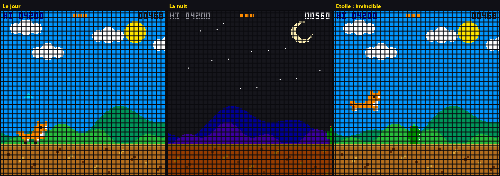

### SCARABEE 3D

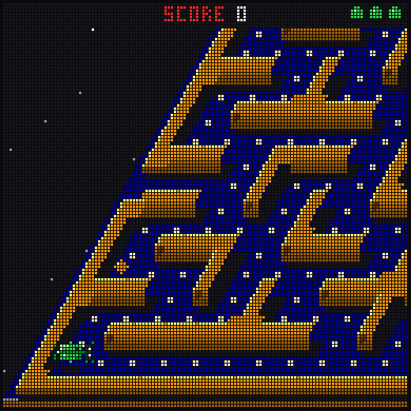

Le labyrinthe du scarabée (mêmes règles que LABYRINTHE, « PAC MANIA » au menu) **vu en relief et en biais** (V4.12 ; décor amélioré en V4.13 ; murs en dégradé et contour bas en V4.14) : les couloirs horizontaux restent horizontaux, la profondeur part en diagonale.
- **Décor :** murs fins en blocs (dessus clair aux arêtes éclairées, face avant et côté gauche en **dégradé**, contour du plateau bas et discret) qui projettent leur **ombre** sur un sol uni bleu nuit, plateau posé sur un **socle**, étoiles autour ; couleurs des murs différentes à chaque stage ; la vue **défile** et suit le scarabée en douceur.
- **Personnages :** créatures piquantes ombrées (9 pixels) aux yeux qui regardent où elles vont, scarabée avec carapace, taches, antennes et pattes qui bougent ; ombres au sol.
- **Commandes :** croix ou stick pour diriger, **✕ ou ○ pour sauter** par-dessus une créature (+100) : l'ombre rétrécit pendant le saut.
- **Mémoire :** l'image est dessinée en mémoire puis envoyée d'un bloc (32 Ko pendant le jeu seulement) : pas de scintillement.

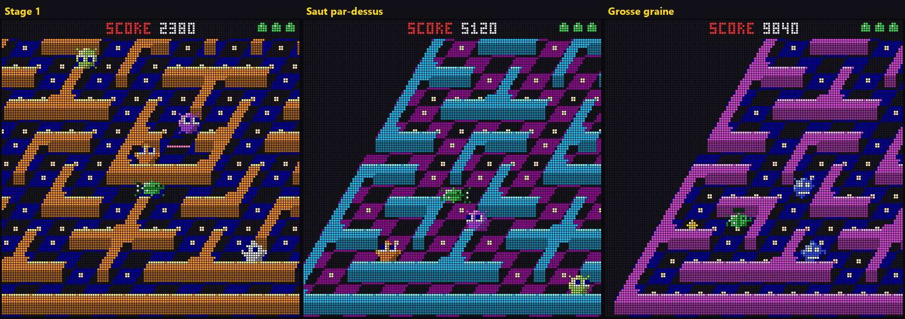

### RALLYE 3D

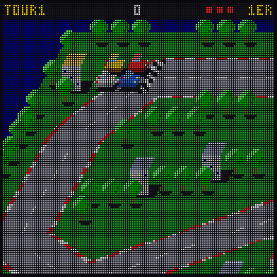

Une course sur circuit originale (V4.14) **vue en relief et en biais**, comme SCARABEE 3D : ta voiture rouge contre 3 adversaires (bleu, jaune, blanc), 3 tours.
- **Commandes (V4.29) :** **croix ou stick gauche : la voiture va dans la direction poussée** (haut = haut de l'écran, diagonales comprises), s'y tourne en douceur et accélère ; **✕ / R2 accélérer**, **○ freiner** ; le stick droit accélère (haut) et freine (bas).
- **Pilotage :** dans l'herbe la voiture ralentit et secoue ; contre un arbre ou un immeuble elle s'arrête (l'image tremble, la manette vibre) ; les voitures se poussent.
- **Course :** départ 3, 2, 1, GO ; le classement (1ER, 2E...) s'affiche en haut à droite. **Dans les 3 premiers** (**les 2 premiers à partir du stage 3**, sauf en facile, V4.34) : stage suivant et bonus ; sinon une vie perdue, on recommence la course.
- **2 joueurs (V4.34) :** menu JOUEURS 2 et une 2e manette : **J2 conduit la voiture bleue** (mêmes commandes) contre les 2 autres. **Écran commun** qui suit le joueur en tête ; celui qui sort de l'écran est **replacé juste derrière l'autre** et attend un peu en clignotant. Les places des deux joueurs s'affichent en haut à droite (J1 en rouge, J2 en bleu) ; vies et score communs ; il suffit qu'un des deux soit qualifié.
- **Progression (V4.34 : plus difficile) :** adversaires plus rapides à chaque stage, jusqu'à la vitesse de ta voiture au stage 7 (plus encore en difficile), 4 décors (verdure, désert, neige, volcan), **circuit en miroir** un stage sur deux, arbres et immeubles placés autrement.
- **Graphisme :** route lisse aux virages arrondis, bordures rouges et blanches, pointillés au centre, ligne d'arrivée en damier ; arbres ronds et immeubles aux fenêtres éclairées avec leurs ombres ; voitures en volume (ombre, caisse, vitres, toit, phares, feux) qui tournent vraiment. La vue défile et regarde devant la voiture. Image dessinée en mémoire (32 Ko pendant le jeu seulement) : pas de scintillement.

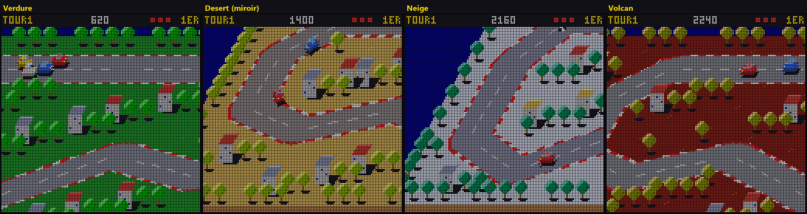

### VORTEX 3D

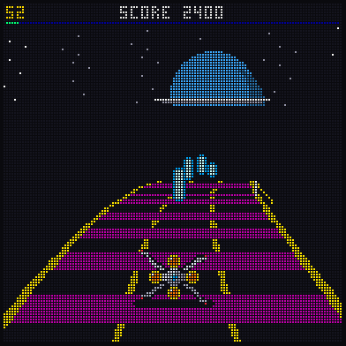

Un tir sur route en 3D original (V4.21 à V4.25, plus rapide et nouveau vaisseau en V4.24) : la route flotte dans l'espace et file vers l'horizon, avec ses **virages en S**, ses **bosses** et sa **plongée** au loin derrière la crête ; une planète à anneau se lève sur l'horizon.
- **Commandes :** gauche / droite (ou stick) pour se déplacer, **haut / bas pour la vitesse**, **✕ pour tirer**, **○ pour sauter**. Dans les virages, la route te pousse vers l'extérieur.
- **Obstacles :** caisses (2 tirs, ou sauter par-dessus), mines (sauter ou tirer), **murs** avec une ouverture où passer, **piliers** violets indestructibles à éviter, **trous** dans la route (à sauter, à partir du stage 2), **soucoupes** qui reculent devant toi et tirent ; **orbe** jaune : double tir 10 s.
- **Stages :** une distance à parcourir (barre verte en haut), puis stage suivant : plus vite, plus d'obstacles, autres couleurs (route, rails, planète).
- **Graphisme :** route en bandes de couleur et bandes noires (moitié moins de LED allumées : moins de courant pour les dalles), rails néon, voies en pointillés, objets à l'échelle de la distance ; vaisseau original avec un **fuselage central** (V4.35 : nez, verrière cyan, dos métal à bande rouge, réacteur arrière qui crache), armature en X en métal avec son épaisseur et 2 réacteurs latéraux incandescents, qui s'incline dans les virages ; **tirs en boules jaunes** lumineuses (halo orange, reflet blanc, V4.35) ; ciel en dégradé sur tout le haut de l'écran et reflet jusqu'en bas (couleurs du stage, V4.32), planète à anneau, lune et géante à bandes en fond (V4.30) ; jeu plus rapide, objets plus près de la route, chasseurs plus nombreux (jusqu'à 2 à la fois) ; **chasseurs** (V4.28) qui descendent des étoiles, se posent au bout de la route, foncent, se placent en face et tirent avant de repartir (3 tirs, 400 points), son ombre sur la route quand il saute. Image dessinée en mémoire (32 Ko pendant le jeu seulement) : pas de scintillement.

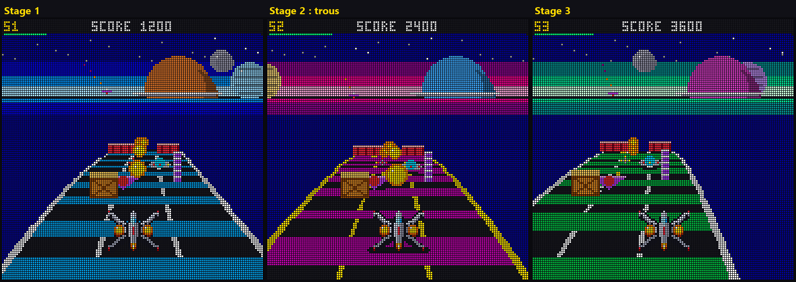

### CRUCH


Des bonbons à aligner sur un plateau de 8 × 8. Six sortes, chacune avec sa couleur et sa forme (rond, carré, losange, triangle, goutte, étoile), pour bien les distinguer.
- **Vies :** de petites pommes en haut à droite.
- **Commandes :** croix ou stick pour déplacer le curseur, **✕ pour prendre un bonbon** (le curseur clignote en jaune), puis une **direction pour l'échanger** avec son voisin. ○ annule.
- **Alignements :** 3 bonbons identiques ou plus disparaissent, ceux du dessus tombent et de nouveaux arrivent par le haut. Les **réactions en chaîne** rapportent de plus en plus. Un échange qui n'aligne rien est annulé.
- **Bonbons spéciaux :** en aligner **4** laisse un **bonbon rayé**, qui vide toute sa ligne ou sa colonne quand il disparaît. En aligner **5** laisse une **bombe** : échange-la avec un bonbon pour faire disparaître toute sa couleur.
- **Niveaux :** un score à atteindre (la jauge à droite) en un nombre de **coups** limité. Réussi : niveau suivant, bonus pour les coups restants et une vie en plus. Raté : une vie perdue, on recommence le niveau.

## Menu

Au démarrage, la dalle affiche **ARCADE GAMES** (en vert), la **version** et les **réglages en cours** (taille de l'écran, couleurs en bits, luminosité, volume) pendant 2 s, le temps que le Bluetooth et le son démarrent.

Sans partie en cours, le jeu tourne tout seul en démo, sans son. **La démo change de jeu au hasard toutes les 5 minutes** (au retour au menu, le jeu choisi est remis). **Sans manette connectée**, la démo affiche seulement une petite indication, « MANETTE : PS + SHARE ». Dès que la manette est connectée, le menu s'affiche **sur son propre écran**, sans la démo derrière. On y voit un fond d'étoiles, le titre ARCADE GAMES et le record avec le nom de son détenteur :

**Les deux manettes pilotent le menu** (V3.96) : choix du jeu, réglages, lancement, saisie du nom, pause.

**Batterie des manettes :** en haut du menu, **la manette 1 à gauche** (chiffres bleus) et **la manette 2 à droite** (chiffres rouges) : un pourcentage et une petite pile (verte, orange, puis rouge qui clignote quand elle est faible). En charge, la pile est jaune, avec un éclair et une jauge qui se remplit en boucle.


| Ligne | Action |
|---|---|
| **JOUER** | **gauche / droite : choix du jeu** (18 jeux ; leurs noms se changent dans le tableau `GAME_NAME` en haut de `games/games.ino`). Au démarrage : le jeu de la démo, tiré au hasard. ✕ ou OPTIONS lance la partie. |
| **NIVEAU** | Facile / Normal / Difficile (gauche / droite ou ✕), choix gardé en mémoire |
| **LUMINOSITE** | 0 à 100 % par pas de 10 % (gauche / droite ou ✕), visible tout de suite et gardée en mémoire. À 0 %, les dalles restent très faiblement allumées pour qu'on voie encore le menu. |
| **VOLUME** | volume du son, 0 à 100 % par pas de 10 % (gauche / droite ou ✕). Un bip fait entendre le niveau. 0 % = muet. C'est le rapport cyclique du PWM : le potentiomètre de l'ampli règle le maximum. |
| **SCORES** | les 5 meilleurs scores **du jeu choisi** : rang, **nom**, score, niveau (F/N/D) et stage atteint. Chaque jeu a son propre tableau. |
| **JOUEURS** | **1 ou 2 joueurs** (gauche / droite ou ✕), une étoile par manette connectée ; seuls les jeux à deux joueurs utilisent la 2e manette |
| **DEMO** | lance **la démo du jeu choisi** : il tourne tout seul avec un pilote automatique, sans texte par-dessus (seules les annonces de stage s'affichent) |

| Réglage du volume | Réglage de la luminosité |
|---|---|
|  |  |

- **Navigation :** la croix haut / bas choisit la ligne, ✕ valide.
- **OPTIONS** (le « START » de la manette PS4) lance la partie depuis n'importe quelle ligne.
- **Mode démo :** au bout de **30 s sans toucher la manette**, le menu se cache et la démo tourne seule. Le premier appui sur un bouton, ou un mouvement du stick, fait revenir le menu, sans autre effet.
- **En partie, OPTIONS ou L2 met en pause** (V3.88 : L2 ajouté, une touche libre) : OPTIONS ou L2 reprend la partie, **○ (rond) revient au menu**. Si ton score entre dans les 5 meilleurs, il est enregistré.
- **Fin de partie :** « GAME OVER » s'affiche. Le jeu revient ensuite au menu, puis passe en mode démo après 30 s.
- **Saisie du nom :** si ton score entre dans les 5 meilleurs, un écran affiche « NOUVEAU RECORD ! » (ou « BRAVO ! RANG n ») puis **3 grandes lettres** à choisir, comme sur une borne d'arcade.
  - Croix haut / bas : change la lettre (A à Z, chiffres, espace, tiret).
  - Gauche / droite, ou ✕ : passe à la lettre précédente ou suivante.
  - ○ : revient à la lettre précédente.
  - OPTIONS : valide. ✕ sur la dernière lettre valide aussi.
  - Le dernier nom saisi est proposé la fois suivante.
  - Après validation, le tableau des scores s'affiche avec ton nom. Sans appui pendant 60 s, le nom est validé tel quel.

| Niveau | Vies au départ | Ennemis |
|---|---|---|
| Facile | 5 | tirent 2 fois moins, piquent moins souvent, tirs plus lents |
| Normal | 3 | — |
| Difficile | 3 | tirent plus, piquent plus souvent, tirs plus rapides |

## Manettes

| Manette | Action |
|---|---|
| stick gauche ou croix gauche / droite | bouger |
| stick gauche ou croix haut / bas | avancer / reculer (dans le bas de l'écran, environ 45 %) |
| croix, carré, triangle, R1, L1 ou R2 | tirer (SPACE DEFENDER, RAID, ORBITUS, BILLES, ESCADRILLE), jet de boue (TAUPE), lancer la balle (CASSE BRIQUES), tourner la pièce (BLOCS), prendre un bonbon (CRUCH) |
| ○ (rond) | bombe dans RAID, saut dans BULLES, tourner dans l'autre sens (BLOCS), annuler (CRUCH) ; dans les menus : retour |
| OPTIONS | jouer depuis le menu, pause en partie |
| L2 | pause / reprise en partie |
| ○ (rond), pendant la pause | quitter la partie et revenir au menu |
| croix haut / bas, au menu | choisir la ligne |
| Share + croix haut / bas | luminosité (enregistrée), aussi réglable dans le menu |
| Share + Options pendant 3 s | redémarrer l'ESP32 |

- **Vibration :** la manette vibre quand ton vaisseau est touché.
- **Barre lumineuse :** bleu sombre au menu et en démo ; **pendant une partie, elle change de couleur à chaque stage** (bleu, vert, jaune, cyan, rouge, violet, en boucle), dans tous les jeux.

**Associer une manette, une seule fois.** Ensuite, le bouton **PS** suffit pour la reconnecter.

1. **Mode association, seulement à la demande** (V3.92) : un appui sur **le bouton « config wifi » du shield** (le même que l'horloge, GPIO 34, capté par interruption : même un appui bref compte) ou la commande `m` du moniteur série. Il dure 60 s ; la dalle affiche « ASSOCIATION 45 / SHARE + PS » dans un cadre, le son est coupé et **la luminosité baisse à environ 10 %** (ton réglage revient à la fin). En dehors de ce mode, l'ESP32 n'accepte pas de nouvelle manette et ne cherche pas en permanence : la radio reste libre. **Les manettes déjà associées se reconnectent toujours avec le bouton PS.**
2. Sur la manette : **PS4** : maintenir **Share puis PS** jusqu'au clignotement rapide de la barre lumineuse. **PS5** : **Create + PS**. **Xbox** : le bouton d'association sur le dessus.
3. La dalle affiche « MANETTE 1 OK » (puis « MANETTE 2 OK » pour la suivante). La 1re manette connectée est le joueur 1 (barre bleue), la 2e le joueur 2 (rouge).

- **Une manette PS4 qui refuse toujours** : écrire l'adresse Bluetooth de l'ESP32 dedans avec **SixaxisPairTool** (manette en USB sur un PC, « Change Master »), puis appuyer sur PS. L'adresse s'affiche dans le moniteur série au démarrage (« Bluepad32 ... pret, adresse ... »). C'est aussi la seule méthode pour une **manette PS3**.
- **Oublier toutes les manettes associées** : commande `a` du moniteur série. Pour en associer de nouveau : bouton du shield (ou `m`), puis Share + PS sur chaque manette.
- **Mémoire (V3.92)** : chaque jeu ne réserve sa mémoire que lorsqu'il tourne (partie ou démo) et la rend dès qu'on change de jeu ; au menu, aucun jeu n'en garde. Il reste ainsi **96 à 98 Ko libres** (83 Ko dans BUNKER 3D) pour le Bluetooth, contre 71 Ko en V3.91. Le moniteur série l'affiche à chaque changement de jeu (« Jeu ... : memoire libre ... »).
- **Redémarrages à la connexion d'une manette** (V3.92) : l'ESP32 ne relance plus la recherche de manettes toutes les 5 s, un appel qui pouvait faire planter la pile Bluetooth (Bluepad32 4.1.0) pendant une connexion. Un plantage de ce type a encore été vu une fois, quand la manette se reconnectait dans les toutes premières secondes après un démarrage ; s'il se reproduit, le moniteur série affiche « assert failed: btstack_run_loop_base_add_timer ».

## Son (option) : une broche PWM


Le son passe par **une seule broche, GPIO 22**. Depuis la V3.11, c'est une vraie **synthèse à 3 voix** :
- **Le signal :** la broche sort un PWM à 250 kHz, dont la valeur est recalculée 16 000 fois par seconde par une courte interruption sur le cœur 0. Le filtre RC n'en garde que le son.
- **Les voix :** les bruitages (onde carrée qui glisse en fréquence), le bruit des explosions et les jingles se mélangent.
- **Le volume :** il change l'amplitude, sans modifier le timbre. L'ESP32 y sort des notes carrées, façon consoles 8 bits, sans I2S et presque sans travail pour le processeur. Le signal est filtré, puis envoyé à un ampli analogique.

- **Le module ampli :** sur le schéma, la carte verte porte la puce au centre, le potentiomètre de volume, l'entrée L / GND / R à gauche, les borniers des haut-parleurs (L+ L- R+ R-) à droite et le bornier d'alimentation + / - en bas. Suis les repères imprimés sur ta carte : l'ordre peut changer d'un vendeur à l'autre.
- **Filtre :** 1 kΩ en série, 10 nF vers la masse, puis 10 µF en série vers l'entrée de l'ampli. Relie l'entrée L à l'entrée R : le son est mono.
- **Amplis NS4110B ou PAM8610 :** ils demandent **7 à 15 V**, pas le 5 V des dalles. Alimente-les avec un bloc 12 V à part, ou avec un élévateur 5 V → 12 V (MT3608, XL6009).
- **Plus simple :** un **PAM8403** (2 x 3 W) fonctionne directement en 5 V.
- **Masse commune** obligatoire entre l'ampli et l'ESP32.
- **Volume :** avec le potentiomètre de l'ampli. Commence au minimum.

- **Bruitages :** tir, explosion, vaisseau touché, piqué d'un ennemi, jingles de stage, de nouvelle arme et de fin de partie, bips du menu et de la saisie du nom. La démo reste muette.
- **Volume :** ligne VOLUME du menu (0 à 100 %), ou `v 0` à `v 10` dans le moniteur série, en plus du potentiomètre de l'ampli.
- **Sans ampli branché :** le jeu marche normalement.

## Ancien son I2S (retiré)

De la V2.01 à la V2.22, le son passait par un ampli I2S MAX98357A (GPIO 22, 21, 33). Le canal audio I2S faisait perdre à la manette PS4 la plupart de ses paquets, et les commandes devenaient lentes, même sans ampli branché. Il a été remplacé en V2.23 par le son PWM ci-dessus, qui ne demande presque rien au processeur. L'ancien code reste dans l'historique Git.

## Branchement


- **(A) Bouton d'association** : le bouton « config wifi » du shield de l'horloge, sur la **GPIO 34** (3,3 V par le bouton, 10 kΩ vers la masse sur le shield).
- **(B) Manettes USB (option, à venir)** : un **RP2040-Zero** lit la manette en USB (adaptateur OTG) et envoie ses touches à l'ESP32 par un seul fil, sur la **GPIO 36 (VP)**, plus le 5 V et la masse. Le programme du RP2040 et sa prise en charge dans le Game hub restent à écrire.

| Écran | Dalles | Montage (ordre de la chaîne) | Commande |
|---|---|---|---|
| 128x128 | 2 | l'une sous l'autre, la 1ʳᵉ (reliée à l'ESP32) en haut | `c 2000` |
| 256x64 | 2 | côte à côte, la 1ʳᵉ à gauche | `c 2100` |
| 128x256 | 4 | l'une sous l'autre, écran vertical façon borne d'arcade, 7 rangées d'ennemis | `c 4000` |
| 256x128 | 4 | carré 2x2 : haut gauche → haut droite → bas gauche → bas droite | `c 4200` |

- **Écran retourné à 180°** (4ᵉ chiffre de la commande à 1, par exemple `c 2010`) : la 1ʳᵉ dalle est en bas ou à droite, ou tout l'ensemble est monté à l'envers.
- **Une dalle sur deux retournée** (dernier chiffre à 1, par exemple `c 2001`) : câblage en serpentin, pour garder des nappes courtes.

**Alimentation 5 V :** 8 A pour 2 dalles, 15 A pour 4. N'alimente pas les dalles par l'USB de l'ESP32.

## Moniteur série (115200 bauds)

| Commande | Effet |
|---|---|
| `?` | aide et état (adresse Bluetooth, dalles, couleurs, volume) |
| `a xx:xx:xx:xx:xx:xx` | adresse Bluetooth que prend l'ESP32, celle de la console. `a` seule revient à l'adresse d'origine |
| `c NDFS` | dalles. N : nombre (1 à 4). D : disposition (0 l'une sous l'autre, 1 côte à côte, 2 carré). F : écran retourné (0/1). S : serpentin (0/1) |
| `p N` | couleurs des dalles sur N bits (3 à 6). **3 bits par défaut** (V4.05 : 4 bits scintillait trop ; chaque borne revient une fois à 3). Rafraîchissement visé : 120 images/s |
| `v N` | volume du son, de 0 à 10 |
| `l N` | luminosité des dalles, de 0 à 100 % (gardée en mémoire, comme la ligne LUMINOSITE du menu) ; `l` seul affiche la valeur actuelle |
| `e 0` / `e 1` / `e x` | test des pertes Bluetooth : LED éteintes / rallumées / transfert vers les dalles arrêté (jusqu'au redémarrage) |
| `j N` | test : lance la démo du jeu N (0 à 17), sans manette |
| `n` | démo : passe tout de suite au jeu suivant (tableau des scores, puis logo) |

Les commandes `a`, `c` et `p` redémarrent l'ESP32. Les réglages sont gardés en mémoire.

**Couleurs et mémoire :** le Bluetooth demande beaucoup de mémoire, surtout à la connexion de la manette. Les dalles sont donc en **3 bits** par défaut. Tu peux essayer `p 4` pour avoir plus de nuances. Si l'ESP32 plante 2 fois de suite, il revient tout seul à 3 bits. Le moniteur série affiche la mémoire libre à la connexion, puis toutes les 2 s.

## Firmware

Le programme utilise une **partition unique de 3 Mo** (« Huge APP », sans mise à jour par wifi). Il y a deux fichiers :

| Fichier | Quand | Adresse |
|---|---|---|
| `GameHub_V<version>_complet.bin` | **1er flash**, ou en venant d'une ancienne version (table des partitions différente) | **0x0** |
| `GameHub_V<version>.bin` | mises à jour suivantes | 0x10000 |

Les réglages (dalles, luminosité, scores, niveau, adresse de la manette, volume) sont conservés.

| Binaire | Adresse | MD5 |
|---|---|---|
| [firmware/GameHub_V4.35_complet.bin](firmware/GameHub_V4.35_complet.bin) | 0x0 | `bdb54b7191ec7b09b3233cf6b9fa9091` |
| [firmware/GameHub_V4.35.bin](firmware/GameHub_V4.35.bin) | 0x10000 | `1cec69baf2e4a5c6d6c69d79bfec9c69` |

Avec l'Arduino IDE, choisis le schéma de partition **Huge APP (3MB No OTA/1MB SPIFFS)** dans Outils → Partition Scheme.

## Compilation

```powershell
./build.ps1    # arduino-cli, carte "ESP32 + Bluepad32" (esp32-bluepad32:esp32 4.1.0), partition Huge APP
               # -> GameHub_V<version>.bin et GameHub_V<version>_complet.bin
```

- **Carte :** installée avec la configuration `build/bp32/arduino-cli.yaml` (adresse du paquet Bluepad32 ajoutée). Le programme d'essai `bp32test/` affiche l'état des manettes et la mémoire libre.
- **Bibliothèques :** ESP32-HUB75-MatrixPanel-I2S-DMA et Adafruit GFX ; Bluepad32 est fourni avec la carte.
- **Manettes :** une petite couche d'adaptation (`PadShim`) garde les noms `PS4.Cross()`, `PS4.LStickX()`... utilisés par les jeux ; `PAD2` lit la 2e manette. L'ancienne bibliothèque PS4Controller (une seule manette, adresse de la console à recopier) reste dans l'historique Git (V3.70, commit `11e9556`).
- **Plans, aperçus et GIF :** `python docs/branchement.py`, `python docs/rendu.py`, `python docs/gif_manette_ps4.py`, `python docs/gif_arrivee.py`, `python docs/gif_menus.py`, `python docs/gif_jeux.py [raid raquettes bulles labyrinthe orbite briques blocs cruch taupe billes escadrille]`, `python docs/gif_bunker.py`, `python docs/gif_turbo.py`, `python docs/gif_renard.py`, `python docs/gif_scarabee3d.py`, `python docs/gif_rallye3d.py`, `python docs/logo_boot.py`, `python docs/gif_vortex3d.py`, `python docs/avions_1945.py`, `python docs/branchement_son.py` (Pillow).

L'ancienne version avec wifi, page web et manette ESP-NOW reste disponible dans l'historique Git, jusqu'au commit `fb11367`.
